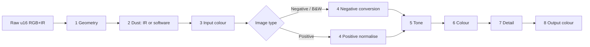

# Negative Vibes: design and development plan

A GNOME application for scanning colour and black-and-white negatives and slides,
on any film-capable scanner that SANE supports.

| | |
|---|---|
| Status | Draft 1, 2026-10-06. Nothing is implemented yet. |
| Requirements | [`negative-scanner-features.md`](negative-scanner-features.md) (feature list, cited here as **F§n**) |
| Reference scanner | Plustek OpticFilm 8200i, USB `07b3:1825` (Genesys GL128), with our `plustek8200i` SANE backend in `~/projects/scanner` |
| UI guidelines | GNOME Human Interface Guidelines, using libadwaita patterns and widgets |
| Licence | GPL-3.0-or-later (see §4.4) |

---

## Contents

1. [Goals and non-goals](#1-goals-and-non-goals)
2. [Design principles](#2-design-principles)
3. [Architecture](#3-architecture)
4. [Technology choices](#4-technology-choices)
5. [Scanner layer: SANE, any device](#5-scanner-layer-sane-any-device)
6. [Data model and storage](#6-data-model-and-storage)
7. [Image pipeline](#7-image-pipeline)
8. [User interface (GNOME HIG)](#8-user-interface-gnome-hig)
9. [Feature coverage](#9-feature-coverage)
10. [Development plan](#10-development-plan)
11. [Testing](#11-testing)
12. [Repository layout and conventions](#12-repository-layout-and-conventions)
13. [Risks and open questions](#13-risks-and-open-questions)

---

## 1. Goals and non-goals

### Goals

- **Turn film into finished digital images** in one application: preview, frame,
  convert negatives, correct, remove dust, sharpen, and export, for single frames and
  whole rolls.
- **Work with every SANE scanner that can scan film.** The app discovers what a device
  can do (transparency source, infrared, resolutions, exposure) and adapts. The
  OpticFilm 8200i with our backend is the reference device, not a special case baked
  into the code.
- **Cover the feature list.** Every P0 item in F§16 is in the first usable release
  (milestone M4). P1 and most P2 items follow (§9 maps every section).
- **Feel like a GNOME application.** libadwaita widgets, adaptive layout, the HIG's
  writing style, keyboard access, and no SilverFast-style floating tool windows.
- **Non-destructive and reproducible.** Keep the raw linear scan (with infrared when
  the scanner has it) and a parameter stack. Every output can be re-rendered later,
  which gives the "HDRi RAW, process later" workflow (F§3) for free.
- **Correct on large data.** A 7200 dpi frame is 10368 × 7755 px, 482 MB as 16-bit RGB.
  The pipeline must stay responsive and bounded in memory at that size.

### Non-goals (for now)

- Flatbed document scanning (GNOME Document Scanner does that well). Reflective
  scanning of photo prints is allowed by the design, but not a priority.
- Camera scanning (DSLR plus light source). The pipeline would support it later
  through "Open raw scans", but tethering is out of scope.
- A general photo editor. Tools exist to finish a scan, not to retouch. Selective
  colour and dodge/burn are the outer limit.
- Printing (PrinTao), descreening, PDF output and line art (F§6, F§10 mark them skip).
- Running on Windows or macOS.

---

## 2. Design principles

These come from the SilverFast survey (F§1, F§17) and the driver work (F§18–21).

1. **Hardware settings and software settings are visibly different.** Resolution,
   infrared, exposure, multi-sampling and scan area need a new scan. Everything else
   only re-renders. The UI groups them separately and labels the ones that need a
   rescan. SilverFast hides this distinction, which F§17 calls its biggest usability
   problem.
2. **The roll is the unit of work, the frame is the unit of output.** Settings live at
   roll level, with per-frame overrides (an idea taken from NegPy, F§19.5). Film base,
   film stock and conversion baseline are roll-wide by default, so frames from one roll
   match each other.
3. **Ask the driver for raw, linear data.** The app turns off driver-side gamma,
   inversion, auto white balance, sharpening and dust removal where it can, and does
   that work itself where it can be controlled and undone. Exceptions are recorded per
   device (§5.5).
4. **Never block the UI.** Scanning, rendering and export run on worker threads. The
   interface shows progress and can always cancel.
5. **Degrade gracefully.** No infrared: offer software dust removal instead. No
   exposure control: no multi-exposure, but multi-sampling still works. No scanner at
   all: open raw scans and keep working.
6. **Measurable quality.** Every processing step has tests on synthetic data and on
   real scans of a reference frame (§11).

---

## 3. Architecture

```mermaid
flowchart TB
  subgraph UI["UI (GTK 4 + libadwaita, main thread)"]
    W[Main window] --- C[Preview canvas]
    W --- S[Frames sidebar]
    W --- I[Inspector: Film / Tone / Colour / Detail / Output]
    W --- Q[Scan queue]
  end
  subgraph Core["Core (no GTK)"]
    R[Roll + frame model, undo stack]
    P[Render engine: pipeline, proxies, tile cache]
    E[Export: TIFF, JPEG, PNG, RAW, DNG]
    F[Film profiles, presets]
  end
  subgraph Scan["Scanner layer"]
    D[Device manager: discovery, capabilities, quirks]
    A[Acquisition worker: libsane thread, frames, progress, cancel]
  end
  SANE[(libsane.so.1 + backends)]
  Store[(Roll folder: roll.json + raw TIFFs)]

  UI <-->|"GObject signals / channels"| Core
  UI <--> Scan
  A --> SANE
  D --> SANE
  A -->|raw linear RGB(+IR)| R
  R --> P --> C
  R <--> Store
  P --> E
```

### 3.1 Components

| Component | Responsibility | Talks to |
|---|---|---|
| `nv-sane` | Safe Rust wrapper around libsane: init, device list, option descriptors and values, start/read/cancel, frame parameters. One dedicated thread owns all SANE calls. | libsane |
| `nv-device` | Capability model (§5.2) built from option descriptors plus a quirks file. Turns "scan frame 3 at 3600 dpi with IR" into SANE option settings and an acquisition plan. | `nv-sane` |
| `nv-acquire` | Runs acquisition plans: preview, scans, multi-sample, multi-exposure, RGB+IR in one or two scans, registration of separate passes. Streams lines into the raw store; reports progress; cancels. | `nv-device`, `nv-image` |
| `nv-image` | Image buffers: planar `u16` raw, `f32` working tiles, a mip pyramid for proxies, a tile cache with a memory budget. | — |
| `nv-process` | The pipeline stages (§7): geometry, dust, input colour, negative conversion, tone, colour, detail, output colour. Pure functions over tiles plus parameter structs. | `nv-image`, lcms2 |
| `nv-film` | Film profile database, roll analysis, film-base estimation, frame detection. | `nv-process` |
| `nv-store` | Roll folders, `roll.json`, raw TIFF read/write, presets, prescan cache. | filesystem |
| `nv-export` | Output encoders and metadata (TIFF/JPEG/PNG/DNG, ICC, XMP). | libtiff via `tiff` crate, gexiv2 |
| `negative-vibes` | The application: GTK widgets, actions, settings (GSettings), the render scheduler that keeps the preview responsive. | everything above |

The core crates have no GTK dependency. They can be tested headless, and a command-line
batch tool (`nv-cli`, M7) can share them.

### 3.2 Threads

| Thread | Work |
|---|---|
| Main (GTK) | UI only. Never touches SANE, never processes full-resolution pixels. |
| SANE worker (1) | Every libsane call, serialised. SANE backends are not guaranteed to be thread-safe, and some (ours included) let `sane_cancel` interrupt a `sane_read` running on another thread, which only works if one thread is reading. |
| Render pool (rayon, N cores) | Preview renders (proxy resolution, cancellable when parameters change), full-resolution tile renders for 1:1 and export. |
| Export/IO (1) | Encoding and writing files, so an export never stalls rendering. |

Communication uses `async-channel`. The UI receives updates as
`glib::MainContext::spawn_local` futures, so no locks are held on the main thread.
Cancellation is a shared `AtomicBool` per job, checked between SANE reads and between
render tiles.

---

## 4. Technology choices

### 4.1 Decision: Rust with gtk4-rs and libadwaita-rs

| Need | Choice | Why |
|---|---|---|
| Language | **Rust** (stable, edition 2024) | 16-bit, multi-hundred-megabyte images need native speed and safe parallelism (rayon). Memory safety matters in a long-running app that holds gigabytes of buffers. Rust is the most common language for new GNOME Circle apps (Loupe, Snapshot, Fractal), so GTK/libadwaita bindings are first-class and kept current. |
| UI toolkit | GTK 4 + libadwaita, via gtk4-rs and libadwaita-rs | Required. |
| UI definitions | Blueprint (`.blp`), compiled to GtkBuilder XML at build time | Readable, diff-friendly, the norm in new GNOME apps. |
| Build | Meson wrapping Cargo (the GNOME Rust app template layout) | Meson installs desktop file, AppStream metadata, GSettings schema, icons, translations; Cargo builds the code. |
| Colour management | lcms2 (`lcms2` crate) | Standard, ICC v4, float transforms. |
| TIFF | `tiff` crate for 16-bit RGB(A) and tags (ICC 34675, XMP 700); libtiff via FFI as a fallback if a feature is missing | Covers TIFF/HDR RAW/HDRi RAW and later DNG tags. |
| JPEG / PNG | `jpeg-encoder` (ICC support), `png` (16-bit, iCCP) | Small, pure Rust. |
| Metadata | gexiv2 (XMP/IPTC/EXIF) through its GObject introspection bindings | Same library GNOME apps use. |
| SANE | Own `nv-sane-sys` (bindgen against `sane-backends-devel` headers) + safe wrapper | No maintained Rust crate covers multi-frame acquisition and option metadata the way we need. The C API is about 15 functions. |
| Parallelism | rayon, async-channel | |
| FFT (registration) | rustfft | Phase correlation for IR and multi-pass alignment. |
| Profiling / IT8 | ArgyllCMS command-line tools (`scanin`, `colprof`) run as subprocesses | Mature; no need to reimplement. Optional at runtime. |
| Help | Mallard pages for Yelp | GNOME standard. |
| Translations | gettext (`gettext-rs`), `po/` | |
| Packaging | Flatpak (GNOME runtime), plus native RPM-friendly Meson install | |

Version floors are what Fedora 44 ships today: **GTK 4.22, libadwaita 1.9, Rust 1.98,
Meson 1.11, blueprint-compiler 0.20, lcms2 2.16, libtiff 4.7, gexiv2 0.16,
sane-backends 1.4**. The Flatpak uses the newest stable `org.gnome.Platform` on Flathub
(51 at the time of writing); check that it ships at least these GTK and libadwaita
versions.

### 4.2 Alternatives considered

- **C with GObject.** Matches our SANE backend and GNOME's core libraries, but a
  multi-threaded image pipeline in C is where memory bugs live. More code for the same
  result.
- **Python + PyGObject on NegPy's core** (the F§19.6 recommendation). It would reuse
  about 52k lines of film-conversion science. Against it:
  - NegPy is an alpha with a single main maintainer and no stable core API, so we would
    have to fork it or chase it.
  - Its dependency stack (numba, OpenCV, wgpu, onnxruntime) is heavy for a Flatpak.
  - Python makes the 7200 dpi memory budget hard to control.

  We keep NegPy as a **design reference**: roll analysis, roll/frame scopes, density-space
  conversion, crosstalk matrices and dust methods are adopted as ideas in §7. Because
  this app is GPL-3.0-or-later, porting a specific NegPy algorithm is legally possible
  with attribution, should that ever be the better option.
- **GEGL as the pipeline.** Good operations library, but its Rust bindings are not
  mature, and our tile, proxy and caching needs are narrow enough to own.

### 4.3 Application identity

- Name: **Negative Vibes**.
- Application ID: `io.github.cschalle.NegativeVibes` (placeholder; it must be a
  reverse-DNS name the author controls, such as their GitHub account, before the first
  release; Flathub requires this).
- Icon: a film-strip frame with a tonal gradient, following the GNOME app icon
  guidelines. Make it in M7, with a symbolic variant.

### 4.4 Licence

**GPL-3.0-or-later.** This permits linking GPL-2+ and LGPL libraries, and lets us learn
from NegPy and pyopticfilm (both GPL-3) and port from them if needed. The SANE backend
in `~/projects/scanner` stays GPL-2.0-or-later and separate: the app only talks to it
through libsane, a dynamic and stable C interface, so the two licences never mix in one
binary.

---

## 5. Scanner layer: SANE, any device

### 5.1 libsane binding

- Link `libsane.so.1` dynamically. That makes the "dll" meta-backend and every
  installed backend available, including out-of-tree ones found through
  `SANE_CONFIG_DIR` and `LD_LIBRARY_PATH` (how we load `plustek8200i` during
  development, §11.4).
- Wrap these SANE calls: `sane_init`, `sane_get_devices`, `sane_open`/`close`,
  `sane_get_option_descriptor`, `sane_control_option` (get, set, auto, with the
  `SANE_INFO_*` flags), `sane_get_parameters`, `sane_start`, `sane_read`,
  `sane_cancel`, `sane_strstatus`.
- Honour `SANE_INFO_RELOAD_OPTIONS` (rebuild the option model) and
  `SANE_INFO_RELOAD_PARAMS` (refresh the size and file-size estimate shown in the UI).
- Device discovery is slow on network backends (escl/airscan). Run `sane_get_devices`
  on the worker, show cached results immediately, and offer **Refresh**.
- Device identity for caches and profiles: `vendor + model + backend name`, plus the
  device name string (`plustek8200i:libusb:003:007` changes on re-plug, so it is not
  used as a key).

### 5.2 Capability model

The app decides what to show from **capabilities**, not from backend names. The
capabilities are detected from option descriptors and verified on the first scan.

| Capability | How it is detected | Used for |
|---|---|---|
| Film source | `source` option (`SANE_NAME_SCAN_SOURCE`) with a value matching `transparen\|film\|slide\|negative\|TPU\|TMA`; or a film-only device with no `source` option (OpticFilm, Nikon Coolscan) | Selecting transmissive mode; hiding reflective-only devices behind "Show all scanners" |
| Film type in driver | Option such as `film-type` (Positive/Negative) | Always set to positive or linear: the app inverts (§2 principle 3) |
| Infrared, same acquisition | Mode values like `Color+Infrared`, or a bool option such as `infrared`; confirmed when `sane_start` returns RGB with `last_frame = false` followed by a GRAY frame, or the frame format `SANE_FRAME_RGBI` (0x10) | iSRD-style dust removal, HDRi RAW |
| Infrared, separate scan | Mode `Infrared`, or a source value containing `Infrared` | Same, after registering the IR scan to the colour scan (§5.6) |
| Bit depth | `depth` option values; prefer 16 | Always scan 16-bit when offered |
| Resolutions | `resolution` (or `x-resolution` / `y-resolution`) word list or range | Resolution choices; "native optical steps" (F§9) are the word-list values, or powers of two of the maximum for ranges |
| Scan area | `tl-x`, `tl-y`, `br-x`, `br-y` (units mm or pixel) | Overscan preview and frame crops |
| Preview mode | `preview` bool | Faster previews |
| Exposure | Options named `exposure*` (ours: a factor 1.0–4.0), per-channel `exposure-r/g/b`, or `analog-gamma`/`gain*` | Multi-exposure (F§2 ME), analogue gain (F§2 AG) |
| Driver-side processing | `custom-gamma`, `brightness`, `contrast`, `auto-*`, `sharpness`, dust/ICE options, `auto-wb` | Neutralise for raw scans (§5.4) |
| Buttons and sensors | Read-only options with `SANE_CAP_HARD_SELECT` | "Scan button pressed" starts the next queued scan |
| Calibration | Button options such as `calibrate` | A Calibrate action in the device menu |
| Progress quality | Measured: whether `sane_read` delivers data during the scan or only at the end | Choose between a real progress bar and a pulsing one with elapsed time |

The **Device Options** page (§8.6) shows every SANE option, grouped as the backend
groups them, so nothing a backend offers is unreachable. Options the app controls
itself (mode, depth, resolution, area, source) are shown there read-only, with a note
that the app manages them.

### 5.3 Acquisition

An acquisition plan is a list of SANE scans, each with option settings, plus a recipe
for combining them:

| Plan | Scans | Combine |
|---|---|---|
| Plain | 1 | — |
| RGB + IR, one acquisition | 1 (two frames, or one RGBI frame) | Split planes |
| RGB + IR, two scans | 2 (Color, then Infrared) | Register IR to RGB (§5.6) |
| Multi-sample ×N | N identical scans | Register, then average (noise falls about √N) |
| Multi-exposure | 2 scans: normal, then long exposure (exposure option) | Register; merge in linear space, weighting each pixel by its signal-to-noise and dropping clipped samples |

Frame handling in `sane_read` must cover everything SANE allows:

- `SANE_FRAME_RGB` and `SANE_FRAME_GRAY`, 8 or 16 bit (16 bit is native-endian).
- **Three-pass** scanners: `SANE_FRAME_RED`, `GREEN`, `BLUE` frames, assembled into RGB.
- **Multi-frame RGB + IR**: RGB frame with `last_frame = false`, then a GRAY frame. Our
  `plustek8200i` "Color+Infrared" mode does this.
- `SANE_FRAME_RGBI` (0x10) for backends compiled with that extension.
- `lines = -1` (unknown height, used by sheet-fed and hand scanners): grow the buffer
  and take the height at EOF.
- `pixels_per_line` and `lines` may differ from the estimate made before
  `sane_start`. Always use `sane_get_parameters` after `sane_start`.

**Streaming into storage.** Lines go straight from `sane_read` into the raw store
(tiled TIFF on disk for large scans, RAM for previews). The app never needs the whole
frame as one buffer, matching the driver's bounded-memory streaming (F§21: a 7200 dpi
scan peaks at 12 MB in the driver).

**Progress** is bytes received over `bytes_per_line × lines`. If no data arrives for
several seconds after `sane_start` (calibration, warm-up, a positioning move), the
queue entry says "Preparing scanner…" with a spinner. Once data flows, it shows a real
fraction with an estimated time left.

**Cancel** sets the job flag. The SANE thread calls `sane_cancel` between reads, and
also from a second thread if a read blocks for more than 2 s; our backend supports
that (F§18 #4, F§21). The device is then marked busy until the next `sane_start`
succeeds or times out. A failed scan leaves the device "needs attention", with a
**Reconnect** action that closes and reopens it.

### 5.4 Raw settings

Before any scan the app sets, where the option exists:

- `custom-gamma` off, `brightness`/`contrast` 0, `auto-*` off (including our
  `auto-wb`), sharpening off, driver dust removal off (including our `ir-clean`);
- film type positive, or linear;
- depth 16;
- mode Color, or Color+Infrared when IR is wanted.

The settings applied are stored in each raw file's metadata (§6.3), so a scan can
always be explained afterwards.

### 5.5 Device quirks file

Behaviour that cannot be detected goes in a data file shipped with the app,
`data/devices.toml`, matched by backend and model regex. Users can override it in
`$XDG_CONFIG_HOME/negative-vibes/devices.toml`. Example for the reference scanner:

```toml
[[device]]
match = { backend = "plustek8200i", model = "OpticFilm 8200i" }
# One 36.5 x 27.2 mm window; the holder is moved by hand between frames.
film-window-mm = [36.5, 27.2]
holder = "manual-advance"            # §5.7
optical-dpi = [300, 600, 1200, 2400, 3600, 7200]
recommended-dpi = 3600               # effective resolution; 7200 adds little
ir = "multi-frame"                   # Color+Infrared: RGB frame, then IR frame
ir-registered = true                 # both passes share geometry; no alignment
exposure-option = "exposure"         # factor 1.0..4.0, linear
neutralise = { "auto-wb" = false, "ir-clean" = false }
preview-dpi = 600                    # fastest useful preview (16.5 s)
streaming-progress = true
```

Entries for other film scanners (Nikon Coolscan via `coolscan3`, Reflecta/PIE via
`pieusb`, OpticFilm GL845 models via `genesys`, Epson Perfection with TPU via `epson2`,
Canon 9000F via `pixma`) are added as they are tested (§11.6). The app must work
without an entry: detection (§5.2) gives a usable default.

### 5.6 Registration of separate passes

Separate IR scans, multi-sample and multi-exposure all need the passes aligned. Use
phase correlation on gradient images (rustfft) to find the integer offset, then refine
to sub-pixel with a parabola fit, the same method `tools/scan-check.py align` uses
(§11.4). The maximum search offset is a preference (default 20 px, as in SilverFast's
iSRD/ME settings, F§14). Our reference scanner returns aligned passes (measured
dy 0, dx 0), so this step is skipped when the quirks file says `ir-registered = true`,
and still verified in tests.

### 5.7 Holders: multi-frame preview versus manual advance

Film scanners come in two kinds, and the roll workflow (§8.4) adapts to which one is
attached:

- **Multi-frame preview** (flatbeds with film guides, motorised strip feeders): one
  preview shows several frames. Frame detection finds them, and batch scan runs
  unattended.
- **Manual advance** (OpticFilm 8100/8200i/8300i and similar): the scanner sees one
  frame window. You push the holder to the next click stop. Batch scan becomes a
  guided loop: scan, then a prompt to move the holder to the next frame (an inline
  banner with a **Scan Next Frame** button), then preview and scan again with the
  roll's settings. When a device has a scan button exposed as a sensor option, pressing
  it continues the loop, so you don't have to touch the computer.

The quirks file declares the kind. Without an entry, a device whose full scan area is
smaller than 40 × 30 mm is treated as manual advance.

### 5.8 No scanner: open raw scans

**Open Raw Scans…** imports 16-bit linear TIFF/PNG/PNM files, including RGB+IR 4-channel
TIFFs, our own HDRi RAW, and the `.pnm` + `-ir.pgm` pairs written by `tools/irscan`.
They become a roll, and every tool except acquisition works. That keeps the app useful
without the scanner, and makes the whole pipeline testable with fixtures (§11.2).

---

## 6. Data model and storage

### 6.1 Objects

```text
Roll
├─ id, name, created, device id, film stock (profile id), notes, metadata preset
├─ settings: RollSettings          roll-wide defaults for every frame
├─ analysis: RollAnalysis          film base, density range, neutral axis (§7.4)
└─ frames: [Frame]
     ├─ id, index (frame number), label, rating/keep flag
     ├─ geometry: crop rectangle (raw pixel space), rotation (90° steps + fine angle), flip
     ├─ raw: RawRef                file(s) in the roll folder, scan settings, IR plane present?
     ├─ overrides: FrameSettings   only the fields that differ from the roll
     └─ history: UndoStack         per-frame, persisted
```

`RollSettings` and `FrameSettings` are one struct, `Settings`, where every field is
optional in an override. The effective settings of a frame are the roll's settings
with the frame's overrides applied. Every tool panel has a scope control (**This Frame
/ Whole Roll**). Changing a roll-wide value with **Whole Roll** selected affects every
frame without an override.

`Settings` groups:

- **Hardware:** resolution, IR on/off, multi-sample count, multi-exposure, exposure
  factor, scan area. Changing these marks the frame "needs rescan".
- **Software:** image type (Negative / Positive / B&W Negative / Kodachrome),
  conversion, tone, colour, detail, dust, output.

### 6.2 Roll folders

A roll is a directory, so it can be backed up, synced and opened later:

```text
Portra400-2026-10-06.nvroll/
├─ roll.json            the model above (versioned schema, see 6.4)
├─ raw/
│  ├─ frame-01.tif      16-bit linear RGB (+ IR as an extra sample), tiled, Deflate
│  └─ frame-01.prev.tif preview scan (overscan)
├─ thumbs/              small JPEGs for the sidebar (rebuildable)
└─ exports.json         what was exported where, with which settings hash
```

Exports go to the output folder the user chose (default `~/Pictures/Scans/<roll>`), not
into the roll folder. Rolls live in `~/Pictures/Scans/Rolls/` by default, and **Open
Roll…** can open one from anywhere.

### 6.3 Raw file format

The raw store is also the **HDR RAW** (F§3, 48-bit linear RGB) and **HDRi RAW** (64-bit
RGB + IR) export format, so "save raw, process later" is not a separate feature:

- TIFF, 16 bit/sample, `PhotometricInterpretation = RGB`; IR as a 4th sample with
  `ExtraSamples = 0` (unspecified); tiled 256 × 256; Deflate with predictor 2.
- XMP packet with a `nv:` namespace (`https://negative-vibes.app/ns/1.0/` or the final
  project URL): device vendor/model/backend, SANE options applied, resolution, exposure,
  passes merged, IR present and IR scale, scan date, app version.
- No ICC profile is embedded: the data is device RGB. The input profile is applied in
  the pipeline (§7.6).

### 6.4 Formats and locations

| What | Format | Where |
|---|---|---|
| App preferences | GSettings schema `io.github.cschalle.NegativeVibes` | dconf |
| Rolls | JSON with `"schema": 1`; migrations in code | roll folders |
| Tool presets (USM, GANE, conversion, scan dimensions, colour-to-grey, …) | One JSON file per preset | `$XDG_DATA_HOME/negative-vibes/presets/<tool>/` |
| Whole-settings presets ("Save Settings…", F§13) | `Settings` serialised | `$XDG_DATA_HOME/negative-vibes/presets/settings/` |
| Film profiles | JSON (§7.4) | shipped: `/app/share/negative-vibes/film/`; user: `$XDG_DATA_HOME/negative-vibes/film/` |
| Metadata presets (IPTC) | JSON | `$XDG_DATA_HOME/negative-vibes/metadata/` |
| Input ICC profiles | `.icc` | `$XDG_DATA_HOME/negative-vibes/profiles/<device-id>/` |
| Prescan cache | Last preview per device | `$XDG_CACHE_HOME/negative-vibes/preview/` |
| Device quirk overrides | TOML | `$XDG_CONFIG_HOME/negative-vibes/devices.toml` |

Auto-save: roll changes are written 2 s after the last edit and on close, atomically
(write to a temporary file, then rename). There is no "unsaved changes" state for rolls
(GNOME HIG: prefer auto-saving).

---

## 7. Image pipeline

### 7.1 Stages

All processing after acquisition is a fixed sequence of stages. Each stage has a
parameter struct and a pure function from input tiles to output tiles. Inactive stages
are skipped.



| # | Stage | Contents | Feature list |
|---|---|---|---|
| 1 | Geometry | Crop to frame, 90° rotation, flip, fine straighten | F§7, F§8 |
| 2 | Dust | IR detection and repair, or software (SRDx-style) detection; masks; Correct / Mark / Off | F§6 iSRD, SRDx |
| 3 | Input colour | Device RGB to linear working space (input ICC or matrix); multi-exposure merge happens before this, at acquisition | F§11 |
| 4 | Conversion | Film base, density inversion, per-channel range, dye gamma alignment, colour cast removal, exposure and tolerance, roll baseline; or positive normalisation | F§4 |
| 5 | Tone | Auto levels, histogram levels, curves (master + R/G/B), midtone/contrast, pipettes (white, neutral, black), scene presets | F§5.1–5.4, 5.7 |
| 6 | Colour | Saturation, global colour balance (shadows / midtones / highlights), selective colour (6 ranges), ACR (faded colour restoration), colour-to-grey (B&W filter presets) | F§5.2, 5.5, 5.6, F§3 SC2G |
| 7 | Detail | Grain and noise reduction (GANE), local contrast (AACO), unsharp mask | F§6 |
| 8 | Output colour | Working space to output profile, bit depth, dithering for 8-bit | F§3, F§11 |

The working format from stage 3 on is linear `f32` RGB in a wide-gamut space (linear
Rec. 2020 primaries, D65 white). Tone curves operate on a perceptual encoding (gamma
2.2, F§5.4's "Gamma for gradation") and convert back to linear.

### 7.2 Rendering: proxies, tiles and caching

- **Proxy pyramid.** When a raw frame is loaded, build a mip pyramid (½, ¼, … down to
  ~1 Mpx) in `u16`. The preview renders the pyramid level just above screen resolution
  for the visible area. A 7200 dpi frame previews at the cost of a ~2–4 Mpx image.
- **Tiles.** Full-resolution work (1:1 view, HQ preview, export) is done in 512 × 512
  tiles, with a margin per stage for neighbourhood operations (USM radius, dust repair,
  noise reduction). Tiles render in parallel.
- **Stage cache.** Each stage's output is cached per tile and pyramid level, keyed by a
  hash of its parameters and the upstream hash. Moving the USM slider re-runs only
  stage 7. The cache has a memory budget (preference, default 25% of RAM; F§13 "RAM
  limit") and evicts least-recently-used tiles.
- **Interactivity.** While a slider is dragged, the scheduler renders a lower pyramid
  level first, then refines. A new parameter change cancels the in-flight render.
- **Display.** Results are handed to GTK as `GdkMemoryTexture` (8-bit sRGB to start,
  then 16-bit or float with a `GdkColorState` for wide-gamut and HDR displays), shown
  in a custom `GtkWidget` that does zoom and pan (`GskTransform` plus texture
  scaling).
- **Statistics** (histograms, auto levels, densitometer) use the proxy by default, and
  full resolution when the "High-resolution data for histograms" preference is set
  (F§5.3).

### 7.3 Previewing filters at 1:1

F§6 asks for whole-frame, 1:1 loupe and HQ previews of heavy filters. Full resolution
exists only after a scan at the final resolution, so:

- If the frame's raw is already at the final resolution, 1:1 renders directly from it.
- Otherwise the **Detail** panel offers **Preview at Scan Resolution**: scan the frame
  (or the loupe region, when the device crops in hardware) at the final resolution, keep
  that raw (the final scan reuses it if nothing hardware-related changed), and render
  1:1. This is the equivalent of SilverFast's automatic 100% prescan (F§6).

### 7.4 Negative conversion

The SilverFast parameter model (F§4.2) and NegPy's density approach (F§19.4) both point
to conversion in **density space** with a measured film base. The design:

1. **Linear transmission.** Raw RGB `T_c`, normalised so the scanner's open light is
   1.0. Our backend calibrates to that per scan; for other devices, use a stored
   open-light reference (taken with **Calibrate Open Light** on an empty holder) when
   available, otherwise the file maximum.
2. **Film base `b_c`.**
   - **Auto:** estimated from unexposed film: the rebate between frames and along the
     edges of the overscan preview, found as the brightest large uniform region that
     is neither the holder (opaque, near 0) nor open light (near 1).
   - **Pipette:** **Pick Film Base** in the canvas.
   - **Roll:** the median of the frames' estimates, the default scope.
3. **Density above base:** `D_c = log10(b_c / T_c)`, clamped at 0. This divides out the
   orange mask without a colour-specific step.
4. **Range.** Per-channel `D_max,c` from the high percentile of `D_c` inside the frame,
   with **Tolerance** controlling the clipped fraction (F§4, default 16, mapped to
   0.16% clipping). Auto measurements ignore a border inset (default 10%, F§5.1
   `AutoFrameInset`).
5. **Dye gamma alignment.** `D'_c = k_c · D_c`, so that the three channels share one
   neutral axis. `k_c` comes from the film profile, or is solved from near-neutral
   pixels (a robust regression of `D_r`, `D_b` against `D_g`). This is **CCR**
   (colour cast removal) in the UI. An optional 3 × 3 **crosstalk matrix** per film
   (dye unmixing, NegPy's idea) applies before alignment.
6. **Print curve.** Map normalised density to positive linear light through an S-curve
   with toe and shoulder, **Exposure** (shift along log exposure) and contrast (slope).
   Output gamma is 2.2 (F§4.2 `GammaOut`) for the perceptual tone stage that follows.
7. **B&W negatives:** a single density channel, computed from the channel weights of
   the chosen colour-to-grey preset (default: green-weighted), no mask.
   Chromogenic B&W (XP2, BW400CN) uses the colour path, then converts to grey.
8. **Roll analysis.** **Analyse Roll** computes base, range and neutral axis over all
   frames, and stores them as the roll baseline. Every frame then starts from the same
   conversion, which is what makes a roll consistent (F§4 "copy NegaFix settings to all
   frames", F§18 #1).

**Film profiles** replace SilverFast's encrypted NegaFix files (F§4.1) with an open
format:

```json
{
  "schema": 1,
  "id": "kodak-portra-400",
  "vendor": "Kodak", "name": "Portra 400", "iso": 400,
  "kind": "colour-negative",
  "base_rgb": [0.62, 0.31, 0.17],
  "gamma": [0.92, 1.0, 1.08],
  "density_max": [1.9, 2.3, 2.4],
  "crosstalk": [[1, -0.05, 0], [-0.08, 1, -0.06], [0, -0.1, 1]],
  "curve": { "toe": 0.15, "shoulder": 0.2 },
  "measured_on": { "device": "Plustek OpticFilm 8200i", "date": "2026-11-01",
                   "method": "unexposed base + grey step wedge" },
  "source": "user"
}
```

The values in this example are placeholders, not measurements. Shipped profiles cover
the F§4.1 stocks over time, starting with Generic, Linear, Monochrome and five to ten
current stocks measured on the reference scanner. **Create Film Profile…** builds one
from a scan of unexposed base plus a grey step wedge. A profile measured on one scanner
is valid on another only through the input ICC profile, so profiles record their device
and the UI says so.

### 7.5 Dust removal

**Infrared (iSRD equivalent, F§6):**

1. **Normalise IR.** Divide by a large-scale smoothed IR (median, then Gaussian) to
   remove illumination falloff. Our backend already flattens and scales IR, so this is
   a no-op there, but other devices need it.
2. **Remove dye crosstalk.** Cyan dye absorbs some infrared, so image content leaks
   into IR. Fit IR density against red density over clean pixels and subtract the
   prediction.
3. **Detect.** Defect where the residual is below `median − k·MAD`; **Detection**
   (F§6, default 12) maps to `k`. Then drop isolated pixels, dilate by 1–2 px, and keep
   components below a size limit, so frame edges and very large regions are never
   "repaired".
4. **Repair.**
   - Small defects: fast-marching inpainting (Telea) on log RGB.
   - Larger ones: patch-based inpainting that keeps the film grain.
   - **Mark** shows the defect map in a colour chosen in Preferences (F§6).
5. **Masks.** Include/exclude brush strokes per frame (F§6 Mask), stored as vector
   strokes in `roll.json`.
6. **Silver B&W film blocks infrared**, so IR dust removal is off by default for B&W
   negatives, with a note in the panel explaining why. It stays available for
   chromogenic film.

**Software (SRDx equivalent):** morphological top-hat detection of small dark or bright
specks (**Defect Type: Dark / Bright**, **Detection**, **Tile Size**), the same repair
and masks. This is the dust tool for silver B&W negatives and for scanners without IR.

### 7.6 Colour management

- **Input:** per device, source and mode, the user's ICC profile if present (built with
  **Calibrate with IT8 Target…**: scan an IT8.7/1 slide, then run ArgyllCMS
  `scanin` and `colprof`; F§11). Otherwise an assumed linear-sRGB matrix. The status
  bar shows the input profile in use (F§1).
- **Working space:** linear Rec. 2020 internally. The user-visible "working space"
  preference (sRGB / Adobe RGB / ProPhoto, F§11) is the output default.
- **Output:** the chosen profile, embedded in TIFF, JPEG and PNG (F§10 P0). Grey output
  embeds a gamma 2.2 grey profile.
- **Display:** convert to the monitor's profile when known (colord), otherwise sRGB.
  Soft proofing is P1.

### 7.7 Other tools

| Tool | Approach |
|---|---|
| Frame detection (F§7 Find Frame) | On the overscan preview: threshold holder vs film; find inter-frame gaps along the film axis (film base is bright on negatives, the gaps are dark on slides); snap to known pitch (36 × 24 mm on 38 mm) when the holder type is known; inset by **Auto Frame Inset** |
| Auto adjust (F§5.1) | Percentile black and white points (thresholds 0.02 / 0.98), midtone balance, cast removal of a set strength; scene presets are parameter sets for the same algorithm |
| Unsharp mask (F§6) | On luminance only, with SilverFast's semantics: **Amount** % (power), **Radius** in output pixels, **Threshold** in 8-bit levels |
| Grain and noise (GANE) | Non-local means on luminance and chroma separately, with presets Light / Medium / Strong |
| Local contrast (AACO) | Contrast-limited adaptive histogram equalisation on luminance, blended by **Effect** |
| Densitometer (F§5.8) | Reads the raw value and the processed value under the pointer: RGB, K, and density; sample size 1 / 3 × 3 / 5 × 5; fixed probes can be pinned |

---

## 8. User interface (GNOME HIG)

### 8.1 How SilverFast's model maps to GNOME

| SilverFast (F§1) | Negative Vibes | Why |
|---|---|---|
| Floating, dockable tool panels | One **inspector** sidebar with view-switched pages; panels are `AdwExpanderRow`s with an enable switch | HIG: no floating utility windows; adaptive layouts need one structure |
| Panel enable checkbox, reset (×), help (?) | Expander enable switch; **Reset** in each panel's menu; a help link to the Yelp page | Same functions, standard widgets |
| Top toolbar (Prescan, Auto, …, Scan) | Header bar: **Preview**, **Scan** (suggested action, split button), queue, main menu | HIG header bar pattern |
| Vertical tool strip | Canvas toolbar (bottom bar) with tool toggles and zoom | Keeps the header bar uncluttered |
| Scanner status queue | **Scan queue** popover from a header bar button with a progress indicator (like Files' operations button) | Familiar GNOME pattern |
| Expert mode / WorkflowPilot | One window with progressive disclosure, plus a **Scan a Roll** guided flow for newcomers (§8.5) | Avoids two different UIs |
| Preferences dialog with tabs | `AdwPreferencesDialog` with pages | Standard |
| Info overlay, tutorials | Yelp help pages, `AdwShortcutsDialog`, tooltips | Standard |

### 8.2 Main window

```text
┌──────────────────────────────────────────────────────────────────────────────────┐
│ [◧]  [Preview]   Portra 400 · 6 frames            ⟲ ⟳  [⤓ 2]  [Scan ▾]   [≡]  │  header bar
│                  OpticFilm 8200i                                                   │
├──────────────┬─────────────────────────────────────────────┬────────────────────┤
│ FRAMES       │                                             │ [Film|Tone|Colour  │
│ ┌──────────┐ │                                             │  |Detail|Output]   │
│ │ ▣ 1      │ │                                             │ Image Type         │
│ └──────────┘ │          ┌───────────────────────┐          │ (Negative|Positive │
│ ┌──────────┐ │          │                       │          │  |B&W)             │
│ │ ▣ 2  ●   │ │          │     frame preview     │          │ Film     Portra 400│
│ └──────────┘ │          │                       │          │ Film Base  Auto  ◉ │
│ ┌──────────┐ │          └───────────────────────┘          │ ▸ Exposure     0.0 │
│ │ ▢ 3      │ │                                             │ ▸ Colour Cast  ✓   │
│ └──────────┘ │                                             │ Scope: (Frame|Roll)│
│ + Add Frame  │                                             │                    │
├──────────────┴─────────────────────────────────────────────┴────────────────────┤
│ ⊕ ⊖ Fit 100%  ⟲ ⟳ ⇋ ⇵   ✎ Frame  ◎ Pipette  ▦ Dust  ◐ Before/After   3600 ppi · 61 MB │  bottom bar
└──────────────────────────────────────────────────────────────────────────────────┘
```

Widget structure:

- `AdwApplicationWindow` → `AdwToastOverlay` → `AdwOverlaySplitView` (frames sidebar,
  start) → `AdwOverlaySplitView` (inspector, end) → `AdwToolbarView` around the canvas,
  with the header bar on top and the canvas toolbar at the bottom.
- **Header bar:**
  - Start: sidebar toggle, **Preview**.
  - Title: `AdwWindowTitle`, with the roll name as title and the scanner as subtitle.
  - End: undo/redo, the scan queue button, an `AdwSplitButton` **Scan** (style
    `suggested-action`; the menu holds Scan Selected Frames, Scan All Frames, and Scan
    Raw Only), and the main menu.
- **Frames sidebar:** a `GtkListView` of frame thumbnails with number, state icon
  (previewed / scanned / needs rescan / exported) and keep/reject. Below it,
  **Add Frame** and **Detect Frames**. On manual-advance devices, a **Next Frame** row
  replaces Detect Frames.
- **Canvas:** a custom widget: zoom, pan, frame rectangles with handles and numbers
  (F§7), pipette and densitometer cursors, dust marks, before/after split view.
- **Inspector:** `AdwViewStack` with an `AdwInlineViewSwitcher` (Film, Tone, Colour,
  Detail, Output). Each page is a scrolled list of `AdwPreferencesGroup`s; heavy filters
  are `AdwExpanderRow`s with an enable switch. Values use `AdwSpinRow` / `GtkScale`
  rows; choices use `AdwComboRow` or `AdwToggleGroup`. Hardware settings carry a
  "needs rescan" suffix icon with a tooltip.
- **Bottom bar:** zoom buttons and level, rotate and flip, canvas tool toggles (Frame,
  Pipette, Densitometer, Dust Mask brush), Before/After, and on the right the resolution
  and expected file size (F§9 live size).

### 8.3 States

| State | What the window shows |
|---|---|
| First start, no scanner | `AdwStatusPage` "No Scanner Found", with **Try Again**, **Open Raw Scans…**, **Open Roll…**, and a help link: "Is my scanner supported?" |
| Scanner found, empty roll | Status page "Insert Film and Preview" with a large **Preview** button, and the film type toggle above it |
| Previewing / scanning | Canvas fills in line by line as data arrives; queue button shows progress; Preview and Scan become **Stop** while busy |
| Scan finished | Toast "Frame 3 Scanned" with **Show in Files**; for manual advance, the banner "Move the holder to the next frame" with **Scan Next Frame** |
| Device lost or error | `AdwBanner` "Scanner disconnected" or the SANE error in plain words, with **Reconnect** |
| Opened roll without its scanner | Everything works except acquisition; Preview and Scan are insensitive, with a tooltip explaining why |

### 8.4 The roll workflow

1. **New Roll** (or start the app): choose the scanner, image type and film stock.
2. **Preview**: an overscan preview. Frames are detected (multi-frame devices), or the
   window becomes frame 1 (manual advance).
3. **Adjust** the first frame with **Whole Roll** scope, so the settings become the
   roll's defaults. **Analyse Roll** is offered once three or more frames are
   previewed.
4. **Scan**: one frame, the selection, or all frames. Each job then:
   - acquires the raw into the roll;
   - renders at full resolution;
   - exports to the output folder with the naming template.

   Jobs overlap: the next frame scans while the previous one exports.
5. **Re-export** at any time: change settings, then **Export** (Ctrl+E) re-renders from
   the raw without rescanning.

### 8.5 Guided flow: Scan a Roll

The equivalent of WorkflowPilot (F§12), and the default for first-time users (a switch
in Preferences turns it off). It is an `AdwDialog` with an `AdwNavigationView`:

1. **Film:** Negative, Slide or B&W; film stock; how many frames.
2. **Purpose:** Archive (raw plus 16-bit TIFF), Share (JPEG, sRGB, 3000 px), Print
   (TIFF, Adobe RGB, 300 ppi for a chosen size), or Custom. Each sets resolution,
   format, profile and naming.
3. **Preview and frames:** a preview with frame detection or the first frame.
4. **Look:** Auto, with three variations to choose from (lighter, neutral, warmer).
5. **Scan:** runs the batch with the manual-advance prompts where needed.
6. **Done:** a summary with **Open Folder**.

### 8.6 Dialogs

- **Preferences** (`AdwPreferencesDialog`, Ctrl+,), mirroring F§14:
  - General: units, output folder, naming template, open after scan, auto-preview at
    start, guided flow.
  - Scanning: preview resolution, always scan IR, IR alignment limit, multi-sample
    default, multi-exposure, exposure alignment limit, completion sound.
  - Colour: colour management on/off, output default, input profiles per device, display
    profile.
  - Performance: memory limit, cache folder, high-resolution histograms.
  - Film profiles: list, import, export, delete user profiles.
- **Device Options** (from the scanner menu): every SANE option, grouped by the backend's
  groups and generated from the descriptors (§5.2). Includes the Calibrate button if
  the backend has one.
- **Export** (Ctrl+E): `AdwDialog` with format, bit depth, compression, quality,
  profile, size presets (F§9 format presets, named pixel sizes), folder, naming
  template preview, and metadata preset.
- **Metadata** (from a frame's menu or Ctrl+I): IPTC/XMP fields with presets (F§10).
- **Keyboard Shortcuts** (`AdwShortcutsDialog`, Ctrl+?), **About**
  (`AdwAboutDialog`), help (F1, Yelp).

### 8.7 Adaptive layout

`AdwBreakpoint`s:

- Below 1100 px wide, the frames sidebar collapses into an overlay.
- Below 800 px, the inspector moves into an `AdwBottomSheet`, and the bottom bar keeps
  only zoom and the tool toggles.

The app stays usable at 360 px wide (phones and tiling). Mostly that matters for
reviewing and exporting, but it costs little with these widgets.

### 8.8 Keyboard shortcuts

GNOME conventions come first. SilverFast's shortcuts are listed so its users can find
the equivalents. Where SilverFast uses a key GNOME reserves (Ctrl+S is Save, Ctrl+X is
Cut, Ctrl+Y is not Redo), we use another key.

| Action | Negative Vibes | SilverFast |
|---|---|---|
| Preview | Ctrl+R | Ctrl+Shift+S |
| Scan selected frames | Ctrl+Return | Ctrl+S |
| Scan all frames | Ctrl+Shift+Return | Ctrl+Alt+S |
| Stop scan | Stop button in the queue (and in the header while busy) | Ctrl+X |
| Undo / redo | Ctrl+Z / Ctrl+Shift+Z | Ctrl+Z / Ctrl+Y |
| Auto adjust | Ctrl+Shift+A | Shift+A |
| Image type Positive / Negative | Ctrl+1 / Ctrl+3 | Ctrl+1 / Ctrl+3 |
| Detect frames | Ctrl+Shift+F | Ctrl+F |
| Next / previous frame | Page Down / Page Up (or → / ← with the canvas focused) | Alt+→ / Alt+← |
| Delete frame | Delete | Ctrl+Backspace |
| Duplicate frame | Ctrl+D | Ctrl+D |
| Copy / paste settings | Ctrl+Shift+C / Ctrl+Shift+V | — |
| Rotate left / right | Ctrl+← / Ctrl+→ (canvas focused) | Ctrl+7 / Ctrl+9 |
| Flip horizontal / vertical | Shift+H / Shift+V | Ctrl+Shift+8 / Ctrl+8 |
| Zoom in / out / best fit / 100% | Ctrl++ / Ctrl+- / Ctrl+0 / Ctrl+1 with the canvas focused | Ctrl++ / Ctrl+- |
| Before / after | Backslash | — |
| Show dust marks and masks | Ctrl+M | Ctrl+M |
| Pipettes: white / neutral / black | W / N / B (canvas focused) | Ctrl+N (neutral) |
| Export | Ctrl+E | — |
| Metadata | Ctrl+I | Ctrl+I (Info) |
| Frames sidebar / inspector | F9 / Shift+F9 | — |
| Open roll / open raw scans | Ctrl+O / Ctrl+Shift+O | — |
| Preferences / shortcuts / help / quit | Ctrl+, / Ctrl+? / F1 / Ctrl+Q | — |

Ctrl+1 means both "Positive" and "100% zoom" in this table. Resolve it in M3: the
image-type shortcuts are global, so zoom 100% becomes `1` with the canvas focused, as in
GNOME Image Viewer. The table is updated when that is decided.

### 8.9 Writing, accessibility, translation

- Follow the HIG writing style:
  - header capitalisation for titles and buttons ("Scan All Frames"), sentence case for
    descriptions and toasts;
  - ellipsis for actions that open a dialog ("Open Roll…");
  - no technical SANE terms in the main UI ("Preview", not "Prescan"; "Scanner
    disconnected", not "SANE_STATUS_IO_ERROR"). The Device Options dialog is the one
    exception.
- Every custom widget implements `GtkAccessible`. The canvas announces the frame, zoom
  and tool. Frame rectangles and curve points are keyboard-operable (arrow keys move
  them, Shift for larger steps).
- Colour is never the only signal: dust marks also have a pattern; clipping warnings
  also show in the histogram as numbers.
- All strings are translatable (gettext), with units formatted for the locale.

---

## 9. Feature coverage

Every section of the feature list, where it lands, and in which milestone (§10).
P2 items marked *skip* in the feature list are not planned.

| Feature list | Coverage | Milestone |
|---|---|---|
| F§1 Layout | §8.1–8.2; panel enable/reset/help in inspector rows; floating windows replaced by the HIG layout | M2–M4 |
| F§2 Device selection, preview, scan, batch, cancel, queue | §5, §8.2 queue, §8.4 | M1, M2, M4 |
| F§2 Infrared | §5.3 plans, §7.5 | M1 (acquire), M5 (use) |
| F§2 Multi-exposure, analogue gain | §5.3 (when the device has an exposure option); per-channel gain via the device options | M7 |
| F§2 Auto-preview at start, cached preview | §6.4 preview cache, preference | M2 |
| F§2 Draft quality, three-line/shutter, completion sound | Draft: `preview` option where offered; three-line/shutter: device options page; sound: preference using `gsound` event sounds | M7 |
| F§3 Image types, 48→24 bit, 16→8 grey | §7.1 image type, §7.6 output | M3–M4 |
| F§3 HDR RAW, HDRi RAW | §6.3 (the raw store is the format) | M4 |
| F§3 Colour-to-grey presets | Stage 6, JSON presets (Red, Orange, Yellow, Green, Blue, Infrared) | M6 |
| F§3 Kodachrome | Positive path with a Kodachrome input profile | M6 |
| F§4 Negative conversion | §7.4 | M3 |
| F§4.1 Film profile database, user profiles | §7.4 open JSON format, profile builder | M6 |
| F§5.1 Auto adjust, scene presets | §7.7 | M3 (auto), M6 (presets) |
| F§5.2–5.4 Quick sliders, histogram, curves | Stage 5; Tone page | M3 |
| F§5.5 Global colour wheel | Stage 6; a custom colour-wheel widget | M6 |
| F§5.6 Selective colour, ACR | Stage 6 | M6 (ACR), M7 (selective) |
| F§5.7 Pipettes | Canvas tools, stage 5 | M3 |
| F§5.8 Densitometer | §7.7, canvas tool plus inspector readout | M6 |
| F§6 USM | Stage 7 | M5 |
| F§6 iSRD, SRDx, masks | §7.5 | M5 |
| F§6 GANE, AACO | Stage 7 | M5 (GANE), M7 (AACO) |
| F§6 1:1 / HQ preview | §7.3 | M5 |
| F§6 Descreening | Skip | — |
| F§7 Frames: draw, detect, select, delete, duplicate, copy settings, reset, flip, per-frame settings, labels | §6.1, §7.7, canvas, sidebar | M2 (geometry), M3 (settings scopes) |
| F§7 Auto frame inset, aspect lock, holder templates | §7.7; holder kinds §5.7 | M2 |
| F§8 Rotate, flip, zoom, navigator, show masks, fine straighten | Stage 1; canvas; a navigator popover in the bottom bar | M2 (basic), M6 (navigator, straighten) |
| F§9 Resolution, live file size, presets, units | Output page and bottom bar; size presets in Export | M2 (resolution), M4 (presets) |
| F§10 Naming, folder, TIFF, JPEG, ICC | `nv-export`, Export dialog | M4 |
| F§10 PNG, DNG, IPTC/XMP presets, open after scan, express scan | PNG and metadata M7; DNG (linear raw) M7; "Scan Raw Only" is express scan (M4) | M4/M7 |
| F§10 PSD, JPEG 2000, PDF, print, share | Skip (P2); share via the portal's "Open With" may come later | — |
| F§11 CMS on/off, input, working, output, IT8 | §7.6 | M4 (basic), M6 (IT8) |
| F§12 Guided mode | §8.5 | M7 |
| F§13 Undo/redo, save/load settings, presets, reset, auto-save | §6.1 history, §6.4, panel reset | M3 (undo), M4 (presets), M2 (auto-save) |
| F§13 Layout presets, tooltips toggle, RAM limit, temp folder | Layout follows the HIG (no panel layouts to save); tooltips are always on (HIG); memory limit and cache folder in Preferences | M7 |
| F§14 Preferences structure | §8.6 | grows with each milestone |
| F§15 Help | Yelp pages per panel, shortcuts dialog | M7 |
| F§18–21 Driver/app split | §5.4 raw settings, §5.2 capabilities, §5.3 streaming and cancel | M1 |
| F§19.5 NegPy ideas | Roll scope and analysis (M3), crosstalk matrices (M6), before/after (M3), keep/reject (M2), multi-pass (M7), dodge and burn and darkroom tools (later, not planned) | — |

---

## 10. Development plan

Each milestone ends with a working app and passing tests. Milestones are scoped by
features, not dates.

| Milestone | Scope | Done when |
|---|---|---|
| **M0 Skeleton** | Repository, Meson + Cargo, application ID, empty `AdwApplicationWindow`, GSettings schema, desktop file and AppStream metadata, CI (build, `cargo test`, clippy, rustfmt), Flatpak manifest | `meson setup build && ninja -C build && ./build/src/negative-vibes` shows a window; CI green; Flatpak builds |
| **M1 Scanner layer** | `nv-sane`, capability model, quirks file, acquisition worker: all frame formats, progress, cancel, streaming to disk; Device Options dialog; command-line `nv-cli scan` for tests | §11.2 test-backend matrix passes; §11.3 simulator passes, including RGB+IR; §11.4 checks H1–H6 pass on the 8200i |
| **M2 Preview and frames** | Preview with the cached preview, canvas zoom/pan, frame drawing and detection, manual-advance flow, roll folders, auto-save, Open Raw Scans, frames sidebar | A roll of six frames can be previewed, framed and saved on the 8200i; Open Raw Scans works with fixtures |
| **M3 Conversion and tone** | Negative/positive/B&W conversion, film base auto and pipette, roll analysis, tone stage (auto, levels, histogram, curves, sliders, pipettes), roll/frame scopes, undo/redo, proxies and stage cache | Golden tests (§11.1) pass; the tulip fixture converts to a plausible positive with Auto; preview stays interactive on a 7200 dpi raw |
| **M4 Output and batch — MVP** | Export (TIFF 8/16, JPEG, HDR RAW, HDRi RAW), ICC embedding, naming, queue, Scan All with manual-advance prompts, Scan Raw Only, presets, basic CMS | Every F§16 item works end to end; scanning a roll on the 8200i gives correctly named files with profiles, and checks H7–H9 (§11.4) pass |
| **M5 Dust and detail** | IR dust removal (Correct/Mark/Off, detection, masks), SRDx, USM, GANE, 1:1 and HQ previews | Dust tests on fixtures (§11.1) and on the reference frame; comparison with SilverFast's iSRD (§11.5) reviewed |
| **M6 Colour and profiles** | IT8 calibration, film profiles (format, builder, first measured stocks), colour wheel, ACR, colour-to-grey, scene presets, densitometer, navigator, straighten, Kodachrome | Profile builder round-trips a step-wedge fixture; IT8 workflow produces a profile accepted by lcms2 |
| **M7 Polish and advanced** | Multi-sample and multi-exposure, DNG, PNG, metadata and IPTC presets, guided flow, AACO, selective colour, help pages, translations, icon, sounds, preference completeness, Flathub submission | HIG review checklist passes (§11.7); translation template complete; Flathub build passes |

**M2 status (2026-10-07).** Built: cached preview written into the roll, frame
selection with thumbnails, drawn scan rectangle, frame detection (`nv-film`,
unit-tested on synthetic strips), add/delete/duplicate/keep/reject, manual-advance
banner, zoom and pan, 2 s auto-save with flush on close, Open Raw Scans into a roll
folder, Open Roll. Not yet verified on hardware: the six-frame roll on the 8200i, and
detection on real previews. Still open: crop handles (the rectangle is redrawn, not
edited), aspect lock and holder templates (F§7), rotation and flip.

**M3 status (2026-10-08).** Built: the editing proxy (decode once, box-reduce to about
2 Mpx) and rendering from it on a worker thread with latest-wins coalescing; a render
cache that keeps the converted picture, so tone, balance and curve edits skip stage 4;
auto levels; histogram; colour-cast removal (a trimmed least-squares fit of red and blue
density against green); per-channel colour balance; four canvas pipettes (film base,
black, grey, white); black, grey and white handles on a levels histogram of the picture
entering the tone stage; master and per-channel curves (monotone cubic, applied in the
gamma-2.2 encoding); roll and frame scopes (`Settings` in `roll.json`: the roll's
defaults, with per-frame overrides, chosen by a Whole Roll / This Frame switch); per-frame
undo history that remembers which scope each step was made in (so undoing a roll-wide
edit puts the roll back) and is saved next to `roll.json` (`history.json`, the last 30
steps per frame); Roll Analysis (median film base, density range and colour axis over the
roll, fixed as roll-wide values; frames are measured inside their own rectangle).
Tests: golden images of the tulip fixture (`tests/goldens/`, including grey-picking the
wall), synthetic B&W-negative and positive checks, the cache, curves, settings, history,
and tiling. Full resolution: `tiles::freeze` fixes what the pipeline measures on the
whole picture (film base, density range, colour axis, a positive's range) from the
proxy, after which tiles render independently and join exactly (tested bit for bit
against a whole-picture render); `TileCache` keeps finished tiles within a memory budget
for the 1:1 view and `render_full` renders the whole frame on several threads for
export. Measured in release on a synthetic 7200 dpi frame (10368 × 7755), warm file
cache, 16 threads: writing the TIFF 0.8 s, reading it 0.6 s, reducing it to the proxy
0.15 s, a first render 0.13 s, a tone-only render 0.06 s, a first 1600 × 1000 view at 1:1
0.26 s (0.13 s when panned over cached tiles), and a full-frame render for export 0.85 s
(`cargo test -p nv-store --release --test big_raw -- --ignored --nocapture`, and
`cargo test -p nv-process --release --test pipeline -- --ignored --nocapture`).
Reading a 7200 dpi TIFF used to fail with `LimitsExceeded` (the `tiff` crate caps a decode
at 256 MB); the reader now lifts that, checks the size itself, and reads strip by strip.
Auto does not guess a colour cast: equalising channel medians turned the tulip wall
blue-green because the scene is mostly red and green. A real silver B&W negative (Ferrania P30, scanned on the reference scanner, CC BY-SA 4.0;
see `tests/fixtures/NOTICE.md`) is now a fixture and a golden: it needed a linear-DNG
reader (`nv-store::dng`: follows the SubIFD, uncompressed 8/16 bit, one or three
samples, black/white levels, every offset bounds-checked and fuzzed by truncation and
byte flips) and is the first real single-channel scan in the tests. Our rendering of it
matches the author's own developed JPEG with a correlation of 0.87 at 96 × 64 (0.15
mirrored), so orientation and polarity are right. Still open: a real slide. The positive
check is synthetic; `tests/fixtures/README.md` says how to add one, and `tests/fixtures.rs`
picks up `slide-*` files and does nothing, saying so, until one exists. The timings above are on a warm file cache, not a cold disk.

**M4 status (2026-10-08), first slice: the output engine.** `nv-export` now has: output
colour spaces (sRGB and Adobe RGB, as a matrix on linear light plus each space's own transfer
curve) with ICC profiles written in code (matrix/TRC v2.4 for RGB, a gamma-2.2 profile for
grey); naming templates (`{roll}`, `{frame:02}`, `{label}`, `{film}`, `{date}`, unique names
by " (2)" suffix, no path escapes); `ExportSettings` (format, depth, compression, JPEG
quality, space, grey, embed profile, folder, template) with the Archive / Share / Print
presets; and encoders that render a frame in tile-high bands and stream it to TIFF (8/16 bit,
none/LZW/Deflate with the horizontal predictor, own writer), PNG (8/16 bit, iCCP) or JPEG (ICC).
Files are written under a temporary name and renamed when complete; a cancelled export leaves
nothing. `copy_raw` is the HDR RAW export (the roll's scan, byte for byte). HDRi RAW waits for
IR capture (M5). The final encode in `nv-process` is now the true sRGB curve instead of a
gamma-2.2 approximation, so the preview and an sRGB export agree; goldens were regenerated
(mean change about 2.4 levels, none far off). Checks: read back with the `tiff`, `jpeg-decoder`
and `png` crates; and an independent colour engine (ImageMagick/lcms) converts our Adobe RGB
export to sRGB with our two profiles and lands on our sRGB export within 1.5 levels. The
`tiff` crate (0.9) corrupts a compressed image written as strips, which is why the TIFF
container is written here. Measured in release on a synthetic 7200 dpi frame (10368 × 7755):
16-bit RGB TIFF with Deflate in 3.7 s and 8-bit uncompressed in 2.4 s, each adding about
265 MB of memory on top of the 500 MB raw and proxy (`cargo test -p nv-export --release
--test export -- --ignored --nocapture`). **M4 status, second slice: the app side.** The window has an export queue (one worker
thread; jobs run in order, equal names get " (2)", a failed job does not stop the rest, a
queued job can be cancelled and a running one stops at the next band and leaves no file), a
header button with a popover of jobs (progress, cancel, Show in Files, Clear Finished), the
Export dialog (Ctrl+E: preset, format, depth, compression, quality, colour space, grey,
profile, folder, name template with a live example, export after each scan, selected or
all scanned frames), export settings stored in `roll.json`, and `exports.json` recording each
file written. A finished export marks the frame Exported and the toast offers the folder.
The Scan button is a split button: Scan Selected Frames, Scan All Frames, Scan Raw Only
(no export afterwards); Preview becomes Stop while the scanner works. A scan is taken inside
the frame's own rectangle, from the stored crop and the preview's size, so Scan All can
scan frames cut from one preview without loading them; on a manual-advance scanner Scan All
is a loop: scan, banner, preview and scan the next frame as soon as the holder is moved.
Tested without a scanner: the queue, the model, the encoders, and a headless import that
exports through the queue (`NV_IMPORT_FILES` with `NV_EXPORT_DIR`). **Not yet tested on the
scanner:** Scan All, Scan Raw Only, Stop, the manual-advance loop, and export overlapping a
scan. **M4 status, third slice: orientation, size, preferences.** Rotate and flip (90° steps,
four buttons in the bottom bar, Ctrl+←/→): a frame keeps an `Orientation` (mirror the scan,
then turn it clockwise), and the canvas, thumbnails and exports show the picture through
it, while everything the pipeline measures, the frame rectangle and the scan area stay in
scan coordinates; only mouse positions and drawing go through the mapping. Export renders
only the part of the scan each band of the turned picture comes from, and a turned export
is bit-for-bit the upright export turned (tested for every rotation and for flips).
Output size (F§9): original, long edge, fit in a box, percent, and the named sizes (Web,
Social, Full HD, HD ready, half); never larger than the scan. Resampling is an exact
area-coverage box filter on linear light, streamed row by row, checked against the
definition at awkward ratios, and against ImageMagick's box resize (within 3 levels on
the tulip; ours averages linear light, theirs the encoded values). The inspector has a
Scan page: resolution from the device's own steps and the live size of the rectangle
("1724 × 1285 px, 12.7 MB as 16-bit colour"). Preferences (Ctrl+,, from the main menu) set
what a new roll starts with (scan resolution, format, colour space, folder, naming,
export after scan), stored as JSON in `~/.config/negative-vibes/` so they need no installed
GSettings schema. Still not done: the output page's remaining F§14 items, XMP metadata
(M7), HDRi RAW (waits for IR, M5), straighten (fine angle, M6), and the scanner checks:
H7 (resolutions and size), H8 (memory: the export side is measured above, the scan side is
not) and H9 (a cropped scan equals the crop of a full one) need the scanner and a person
at it. Everything in Scan All, Scan Raw Only, Stop and the manual-advance loop is still
untried on hardware.

**Hardware results, OpticFilm 8200i with the packaged `plustek8200i` backend, tulip
negative (2026-10-08).** Run through `nv-cli scan` (same acquisition worker as the app) and
through the app itself with headless hooks (`NV_AUTOSCAN=raw|scan|all`,
`NV_AUTOSCAN_STOP=1`; they preview, scan, press Stop at 30%, and quit when done).

| Check | Result |
|---|---|
| H1 app raw equals driver output | Pass: 600 dpi app scan vs `scanimage`: dy +0.04 rows, dx 0, ncc 0.9996. The app's own roll file (1200 dpi, averaged to 600): dy +0.04, dx 0 |
| H2 repeatability | Pass on alignment: dy 0.00, dx 0, ncc 0.9997. The bands' lowest ncc is 0.9978, just under the 0.998 bar |
| H3 progress is real | Pass: the driver climbs 31% at 10.4 s, 63% at 13.2 s, 94% at 16.0 s after about 7.6 s of positioning; the app showed steps of about 8% |
| H4 cancel | Pass: Stop at 30% of a 1200 dpi scan returned in 0.07 s; the next scan succeeded and aligned (dy +0.05) |
| H5 RGB + IR | Pass (run in M5): the app's RGB+IR scan has dy 0, dx 0 between IR and colour; IR median 46505 against the reference's 45855 |
| H6 raw settings | Pass: `ir-clean` 0 (logged), `auto-wb` off by default and neutralised by the quirks file, depth 16, mode Color |
| H7 resolutions and size | 3600 dpi in 35 s: dy +0.22 rows against the 600 dpi reference, 0.02 over the ±0.2 bar. 7200 dpi in 73 s (482 MB): dy +0.17, within it |
| H8 memory | Found and fixed (below). `nv-cli` holds a 7200 dpi frame once (509 MB peak) |
| H9 crop | Pass: a 50% × 60% area scan equals the same region of the full scan (dy +0.03, dx 0, ncc 0.9991); it lands one pixel up and left of the requested origin and one row short (432 × 386 against 432 × 387), which is the device's step size |

Through the app: Scan Raw Only saved a 1728 × 1291 16-bit RGB raw with no export; Scan All on
this manual-advance scanner scanned the previewed frame, exported it (TIFF, sRGB profile) and
marked the frame Exported. **H8 finding:** the app peaked at 3.0 GB importing and exporting a
7200 dpi frame, because the whole file was read into memory and byte-swapped, the TIFF writer
made two more copies, and the canvas, the thumbnail and the export each held the 482 MB frame.
Fixed: the raw writer and the PNM reader stream; a big raw is shown from a working-size copy
built a strip at a time (`RawReader::proxy`), which is also what its thumbnail uses; the frame
is read whole only to export it. The same run now peaks at 1.3 GB, which is the import's copy,
the export's read, its band and the GTK baseline. Not exercised: the Stop button itself (the
action it calls was), the banner click that continues a manual-advance loop (it needs the
holder moved), and exports overlapping a scan of the next frame.

**M5 status (2026-10-08), first slice: infrared and dust.** The app now captures the
infrared plane (a second frame from the 8200i, delivered as `IrFrameStarted` plus chunks;
a Capture Infrared switch on the Scan page, on by default when the scanner can) and stores
it as the fourth sample of the raw TIFF (ExtraSamples unspecified; the HDRi RAW layout, so
HDRi RAW export is `copy_raw`). Raws are written and read with the plane (8 and 16 bit),
a `.pnm` with a `-ir.pgm` beside it reads as one four-channel scan (what `irscan`
writes), the working-size copy carries the plane (`Proxy::ir`, also built a strip at a
time), and the CLI's `render` has `--dust off|correct|mark`. **Hardware:** H5 passes: the
plane is aligned with the colour (dy 0, dx 0) and its levels match the reference (median
46505 against 45855). **Dust removal** (`nv-process::dust`, pipeline stage 2, before
conversion): the infrared is fitted, robustly and jointly, to a degree-4 surface (the
lamp's falloff, which a box blur could not follow near the film edge: it flagged a stripe
down the left side) plus the ghost of the picture's red density (cyan dye absorbs
infrared); what lies well below the fit, by a margin set from the plane's own noise, is a
candidate; candidates are joined (eight-way, since a hair is a thin diagonal), kept if
plausibly small, grown to a disc, and repaired from their surroundings in log
transmission, working in from each mark's edge. Modes Off / Correct / Mark (marks painted
magenta on the finished picture); Detection 1 to 20 sets the margin from 120 to 6 noise
units. Silver B&W defaults to Off. The Detail page has the controls and says so when the
scan has no infrared. Full-resolution tiles render with a 24-pixel margin so repairs at a
tile's edge see their surroundings; tiling plus dust agrees with the whole-picture render
within 1% of samples by more than 8 levels (it cannot be exact: each tile measures its own
lamp surface and noise). On the tulip at default sensitivity it finds 114 marks over 0.8%
of the picture (24 at 6, 271 at 20); the large specks, hairs and scratches go, but the fine
white sparkle of this film, which is not in the infrared plane, stays. The cleaned golden
images were regenerated. **M5 status, second slice: detail, software dust, loupe.** *Stage 7 detail* (`nv-process::detail`):
unsharp mask (amount, radius in pixels of the finished picture, threshold in 8-bit levels,
on luminance of the sRGB-encoded picture, colour untouched) and grain and noise reduction
(non-local means, Light / Medium / Strong, on luminance and, harder, on colour
differences; done offset by offset with a box filter over the difference image, so it is
a few passes over the picture, not a loop per pixel). Noise reduction is left out of the
whole-frame preview (`Quality::Preview`) and applied at 1:1 and in exports; the USM radius
shrinks with a proxy's reduction and does nothing below a third of a pixel. Tiles render
with a margin sized by what is on (dust 24 px, USM three radii, NLM 5 px), and tiles with
detail on join the whole-picture render to within 1e-4. **Software dust (SRDx):**
`DustMethod::Software` finds small specks in the picture itself with a morphological
top-hat on log transmission (dark, bright or both), keeps only compact marks (a long thin
mark is the picture's own detail: a rim, a hair of a glass), and uses the same mark
filtering and repair as the infrared path. On the silver B&W negative it still marks some
of the sunglass reflections and glass highlights at the default, which is its known limit
and why B&W stays Off by default and why brush masks matter. **Infrared:** bright defects
(an emulsion scratch is bright in the plane) are found when Defect Type is Bright or Both;
Mark's colour is a preference. **The 1:1 loupe:** a toggle in the bottom bar shows 360 × 360
pixels of the picture at the scan's own resolution around the pointer, with every filter at
full quality, rendered off the UI thread after the pointer rests; a big scan is read from
disk for just that block (`RawReader::region`, a few strips), and the block equals the same
place on the whole picture to within one level, upright or turned. **Cost** on a synthetic
7200 dpi frame, release, 16 threads: a 16-bit Deflate export with sharpening and Medium
noise reduction takes 19 s (3.6 s without), peaking 425 MB above the raw.

**M5 status, third slice: brush masks.** Three canvas tools in the bottom bar: **Protect**
(dust removal must leave the picture alone here: stars, eyelashes, fine detail that looks
like dust), **Heal** (repair here, whether or not anything was detected, and with no
infrared at all) and **Unmask** (take strokes back). Brush size is a setting in the Detail
page, as a percentage of the scan's longer side, and Clear Masks empties the frame. A
stroke is stored as points in fractions of the whole scan plus a radius (a fraction of the
long side), so it means the same at any zoom, on a proxy, in a tile, in the loupe and in an
export, and it follows the picture when it is rotated. For that a proxy now knows where it
sits in its scan (`Proxy::origin` and `full`, kept through reduction, regions and crops) and
`dust::rasterise` paints strokes onto whatever block is being rendered. Strokes belong to
the frame whatever scope is selected (never the roll's), are saved in `roll.json` as the
frame's overrides, are drawn over the picture in green (protected) and red (healed), and
are one undo step each, with the rest of the frame's history. Tested: a stroke's area and
position, the same coverage at half size and in a block cut from the scan, the eraser (it
follows paths, not just points), protect and heal on synthetic dust (heal also with no
infrared), strokes through JSON and old settings, and a stroke landing at the same place in
a tiled export as in the whole-picture render. 

**M5 status, fourth slice: registration, patch repair, local contrast, HQ view.**
*Infrared registration* (F§6, up to 20 px): the offset between the infrared plane and the
colour is measured by correlating their edges (coarsely over the range, then finely, then
to a fraction of a pixel with a parabola through the peak), applied by bilinear resampling
before detection, ignored under a quarter of a pixel, and frozen from the proxy so every
tile uses the same one; it is found to a few tenths of a pixel on synthetic offsets up to
12 px and finds essentially none on the real scan, which agrees with the 8200i delivering
registered planes. (The test image is value noise, not a checkerboard: edges have no
polarity, so a regular pattern matches itself half a period away.) *Patch repair:* marks
over 30 pixels (hairs, scratches) are filled by copying the best-matching patch from the
nearby picture, brought to the local brightness and colour, working in from the mark's edge,
so the grain runs through the repair; small marks keep the smooth fill, and blotches over
6000 pixels are smoothed rather than searched, to bound the cost. *Local contrast (AACO):*
contrast-limited adaptive equalisation of brightness on an 8 × 8 grid of cell histograms,
interpolated between cells and bins and blended by an Effect percentage; the grid is
measured once on the whole picture by `freeze` and addressed by each block's place in the
scan, so tiles, the loupe and exports equalise as the whole picture does (a block rendered
with the grid equals the same block of the whole picture, and a grid measured on a reduced
copy differs from the full one by under 0.02 on average). Adaptive equalisation can dip a
little at a cell boundary on a steep ramp, which is inherent to it. *HQ view:* a toggle in
the bottom bar renders the region on screen at the scan's resolution with every filter,
when zoom is 1:1 or more, and lays it over the canvas under the frame and the strokes; it
reuses the loupe's renderer and follows scrolling and zoom. Still not done: trying the loupe,
the HQ view and the mask tools with a real pointer on screen, the comparison with
SilverFast's iSRD (§11.5), which needs SilverFast, and the IR/colour alignment on a scanner
that does not deliver registered planes.

Early implementation order inside M1 to M3, to reach a demo quickly:

1. `nv-sane` with the test backend, from a unit test;
2. preview into a `GtkPicture`;
3. the 8200i preview;
4. a crude inversion;
5. the real pipeline.

---

## 11. Testing

Testing has four layers. Only the last needs the scanner.

| Layer | Needs | Runs in CI | Catches |
|---|---|---|---|
| 11.1 Unit and golden-image tests | fixtures in `tests/fixtures/` | yes | pipeline maths, file formats, model logic |
| 11.2 SANE `test` backend | sane-backends | yes | frame formats, option handling, progress, cancel, odd parameters |
| 11.3 Film scanner simulator (`sane-nvsim`) | our small backend in `tests/sane-nvsim/` | yes | RGB+IR acquisition, manual advance, slow devices, errors, using real film data |
| 11.4 Real hardware: OpticFilm 8200i | the scanner, `~/projects/scanner` | no (manual or scripted) | the real driver contract: position, progress, cancel, IR, timing |
| 11.5 Comparison with SilverFast | the Windows VM harness | no | conversion and dust-removal quality against a reference |

### 11.1 Unit and golden-image tests

- Every pipeline stage has tests on synthetic input with a known answer. Examples:
  - Inverting a synthetic negative made from a known positive and a known orange mask
    gives back the positive within a set tolerance.
  - A specked IR plane yields exactly the specks.
  - USM on a step edge gives the expected overshoot.
- **Golden images** for whole pipelines run on the fixtures from the real scanner,
  `tests/fixtures/plustek8200i/`:

  | File | Contents |
  |---|---|
  | `tulip-600.pnm` | 864 × 645, 16-bit linear RGB, colour negative, reference "tulip field" frame, Color+Infrared mode, 600 dpi |
  | `tulip-600-ir.pgm` | Its infrared plane, pixel-aligned (verified: dy 0, dx 0) |
  | `tulip-600-repeat.pnm` | The same frame scanned again (scan-to-scan noise, repeatability; aligned to +0.04 rows) |

  Golden outputs are stored as 16-bit PNG, compared with a tolerance (max ΔE2000 and
  mean). Update them deliberately with `cargo test -- --ignored update_goldens`, and
  review the visual diff in the MR.
- Add fixtures as features need them, kept small (600 dpi, ≤ 5 MB each):
  - a B&W silver negative, to verify dust removal stays off;
  - a slide;
  - unexposed film base;
  - a grey step wedge;
  - an IT8 target scan;
  - a frame with deliberate dust.

  Capture them with the commands in §11.4.

### 11.2 SANE test backend (no hardware)

sane-backends includes a `test` backend that produces synthetic images and can emulate
many backend behaviours. Use a private SANE configuration so tests never depend on the
desktop's setup:

```sh
mkdir -p tests/sane-config
printf 'test\n' > tests/sane-config/dll.conf
printf 'number_of_devices 2\n' > tests/sane-config/test.conf
export SANE_CONFIG_DIR=$PWD/tests/sane-config
scanimage -L                      # test:0 and test:1
scanimage -d test:0 --help        # lists its options
```

The integration tests (`cargo test -p nv-acquire --features sane-test`) drive `test:0`
through `nv-sane` with option combinations including:

- mode Color / Gray at depths 8 and 16;
- **three-pass** colour (`--three-pass=yes`, with `--three-pass-order`), at depth 8
  and 16; scanimage itself only assembles 8-bit three-pass, so the app must not
  copy that limit;
- **unknown height** (`--hand-scanner=yes`, `lines = -1`);
- slow delivery for progress (`--read-delay=yes --read-delay-duration=…`);
- small reads (`--read-limit=yes --read-limit-size=…`);
- cancel during `sane_read`;
- test pictures (`--test-picture="Color pattern"` / `Grid`) to verify assembly
  byte-for-byte.

Run `scanimage -d test:0 --help` for the exact option names in the installed version
before writing a test against one.

### 11.3 Film scanner simulator: `sane-nvsim`

The test backend cannot produce infrared, film content, or manual-advance behaviour. So
the project includes a small SANE backend, written in C under GPL-2.0-or-later like
SANE (it is a separate program; the app only loads it through libsane). It is about 600
lines, under `tests/sane-nvsim/`, built by Meson only for tests. It serves the fixtures:

- **Modes** Color, Gray, Infrared and Color+Infrared, with the same two-frame convention
  as `plustek8200i` (RGB frame with `last_frame = false`, then a GRAY IR frame).
- **Options** `resolution` (it resamples the fixtures), `depth`, `tl-x`…`br-y`,
  `preview`, `exposure`.
- Test behaviours selected by options:
  - `ir-style` = multi-frame / rgbi / separate-scan;
  - `ir-offset` (shift the IR plane, to test registration);
  - `latency` (delay before the first data, like the 8200i's calibration);
  - `rate` (bytes per second);
  - `fail-at` (return an I/O error after N bytes);
  - `frames` (a list of fixtures, so each `sane_start` returns the next one, emulating
    manual advance).

Use it like any backend:

```sh
printf 'nvsim\n' >> tests/sane-config/dll.conf
export SANE_CONFIG_DIR=$PWD/tests/sane-config
export LD_LIBRARY_PATH=$PWD/build/tests/sane-nvsim
scanimage -d nvsim --mode Color --format=pnm > /tmp/sim.pnm
~/projects/scanner/tools/irscan/irscan -D nvsim -r 600 /tmp/sim   # RGB + IR frames
```

Its correctness is checked against the real driver: `irscan` output from nvsim and from
the 8200i must have the same frame structure and parameters for the same options.

### 11.4 Real hardware: OpticFilm 8200i with the plustek8200i backend

**Setup.**

1. Build the backend. Leave out `plustek8200i-motor-standalone.c`, which duplicates
   symbols. `tools/build.sh` in the scanner repo points at an old path, so don't use it.

   ```sh
   cd ~/projects/scanner/backends/backend
   CF="-fPIC -Wall -DHAVE_CONFIG_H -D_GNU_SOURCE -DV_MAJOR=1 -DV_MINOR=3 \
       -I. -I../include -I../include/sane -I/usr/include/libxml2"
   SRCS=$(ls plustek8200i*.c | grep -v motor-standalone)
   gcc $CF -c $SRCS
   gcc -shared -o libsane-plustek8200i.so.1 ${SRCS//.c/.o} \
       ../sanei/.libs/libsanei.a -lusb-1.0 -lm -lpthread -lxml2
   ```

2. Point SANE at it. `~/.sane/dll.conf` already lists `plustek8200i`.

   ```sh
   export SANE_CONFIG_DIR=~/.sane
   export LD_LIBRARY_PATH=~/projects/scanner/backends/backend
   scanimage -L          # device `plustek8200i:…' is a Plustek OpticFilm 8200i
   ```

   Run the app the same way, for example `meson devenv -C build negative-vibes` with
   those two variables set. In a Flatpak, see §13 (R4).
3. The scanner must belong to Linux, not the Windows VM. Release it from the VM with:

   ```sh
   virsh -c qemu:///system detach-device win11 \
     ~/VirtualMachines/harness/etc/hostdev-plustek.xml --live
   ```

   Use `attach-device` with the same file to hand it back.
4. Load the **reference frame**: the tulip field negative, in the strip holder.
5. Build the IR client: `make -C ~/projects/scanner/tools/irscan`.
6. Install the checker's dependencies (numpy and Pillow are present). Add
   `python3-tifffile` to read TIFF output: `sudo dnf install python3-tifffile`.

**Tools from the driver work, and what each is for:**

| Tool | Location | Use in app testing |
|---|---|---|
| `scan-check.py` | `tools/` in this repo | Measurements: stats, alignment (to 0.05 row), per-band match, IR alignment, exact diff, downsample, quick preview, scanimage progress timing |
| `irscan` | `~/projects/scanner/tools/irscan/` | Reference client for the two-frame Color+Infrared mode; writes `.pnm` + `-ir.pgm`; `-D` picks the device (also works with `nvsim` and `test:0`) |
| `scanimage` | sane-backends | Reference acquisitions for comparison; `-p` for progress |
| Driver debug log | `SANE_DEBUG_PLUSTEK8200I=3` | Timing of each phase ("Streaming: first data after …", feed time), cancel path, calibration results |
| `PLUSTEK8200I_STREAMCHECK=1` | driver env | The driver compares its streaming and ring-buffer output with the full-buffer path on a real scan (should log "0 samples differ") |
| `PLUSTEK8200I_STREAM=0`, `PLUSTEK8200I_FASTFEED=0` | driver env | Old buffered behaviour (no progress) and old slow positioning: check the app copes with a backend that buffers |
| usbmon capture | `sg wireshark -c "tshark -i usbmonN -w out.pcapng"` (no root needed); or `sudo ~/VirtualMachines/harness/bin/usbcap <label> [s]` | What the app actually did on the wire; compare with scanimage runs |
| `gl128_timeline.py` | `~/projects/scanner/tools/recon/` | Readable timeline of a capture (register writes, feeds, bulk reads) |
| `kasa_control.py off\|on` | `~/projects/scanner/` | Power-cycle the scanner (smart plug, reachable from home). Needed if a failed scan leaves the ASIC wedged |

**Acquisition contract checks.** Run these when the scanner layer changes, and before
each milestone. `REF` is a reference scan made with scanimage just before, at the same
settings; `APP` is the app's raw output for the same frame (`raw/frame-NN.tif` in the
roll folder, or an HDR RAW export).

| # | Check | How | Pass |
|---|---|---|---|
| H1 | App raw equals driver output | `scan-check.py stats` on both; `scan-check.py align REF APP` | Same size; dy within ±0.2 rows, dx 0; ncc ≥ 0.999 |
| H2 | Repeatability (same frame twice) | Two app scans, `align` and `bands` | ±0.2 rows; uniform bands ≥ 0.998 |
| H3 | Progress is real | During an app scan at 600 dpi or more, the queue fraction rises steadily after the first data. Cross-check the driver with `scan-check.py progress -- -d plustek8200i --format=pnm --mode Color --resolution 600`, which shows ~10% steps over several seconds | No jump from 0 to 100%. (scanimage's own display is coarse at 300 dpi, so use 600 or more.) |
| H4 | Cancel | Stop at ~30% of a 1200 dpi scan, then scan again | Stop returns within 2 s; the next scan succeeds and aligns with REF (H1) |
| H5 | RGB + IR | App scan with IR on; compare with `irscan -r 600 ref` | Colour frame passes H1 against `ref.pnm`; `scan-check.py iralign APP_RGB APP_IR` shows dy 0, dx 0; IR median in the same range as `ref-ir.pgm` |
| H6 | Raw settings | Driver log of an app scan | `auto-wb` and `ir-clean` off; depth 16; with IR, mode Color+Infrared |
| H7 | Resolutions and size | App previews at 600 and scans at 3600 and 7200; `scan-check.py down` to 600 and `align` with a 600 REF | dy within ±0.2 rows of 600-dpi rows at every resolution; 7200 dpi finishes (~51 s in the driver alone) |
| H8 | Memory | `/usr/bin/time -v` around the app, or GNOME System Monitor, during a 7200 dpi scan with export | Peak stays within the configured memory limit plus the one frame being exported |
| H9 | Crop | App scan with a frame smaller than the window | The output equals the corresponding crop of a full-window scan (`align` on the crop) |

Example session for H1 and H5:

```sh
S=$(mktemp -d)
scanimage -d plustek8200i --format=pnm --mode Color --resolution 600 > $S/ref.pnm
~/projects/scanner/tools/irscan/irscan -r 600 $S/refir          # refir.pnm, refir-ir.pgm
# … scan the same frame in the app, IR on, Scan Raw Only, export HDRi RAW to $S/app.tif …
./tools/scan-check.py align $S/ref.pnm $S/app.tif
./tools/scan-check.py iralign $S/refir.pnm $S/refir-ir.pgm
```

The HDRi RAW TIFF carries IR as its 4th sample. `scan-check.py` reads the first three
channels as colour; extract the IR with `tifffile` when comparing it.

**When something goes wrong:**

- Keep `SANE_DEBUG_PLUSTEK8200I=3` on in testing sessions. Copy the log next to the
  roll folder in bug reports.
- A scan that times out, or a "DMA setup failed" in the log, can leave the scanner
  wedged. Power-cycle it (`kasa_control.py off`, wait 5 s, `on`, then wait for
  `lsusb | grep 07b3`), and if the plug is unreachable, do it by hand.
- If the app and scanimage behave differently, capture both with usbmon and compare
  their timelines with `gl128_timeline.py`. The app should only ever differ in its
  option settings and its read sizes.
- If a frame lands in a different place every time, check H2 with scanimage alone
  first, to separate driver problems from app problems.

### 11.5 Comparison with SilverFast (Windows VM harness)

SilverFast 9 SE Plus in the `win11` VM is the quality reference for conversion and dust
removal. It is not a pixel-exact target.

1. Hand the scanner to the VM (`virsh … attach-device … hostdev-plustek.xml --live`).
2. Start the off-screen session with `~/VirtualMachines/harness/bin/winctl up`. Drive
   SilverFast:
   - Prefer `winctl exec` for anything scriptable.
   - The GUI is reachable with `winctl shot` / `click` / `key` / `type`; screenshots
     show the current state.
   - Scan the reference frame at 600 dpi, and export:
     - an HDR RAW (48-bit, no processing);
     - a NegaFix-converted TIFF (Auto, matching film stock);
     - a TIFF with iSRD on.
3. Copy the files out with `winctl pull 'C:\Users\…\file.tif' ./silverfast/` and detach
   the scanner back to Linux.
4. Compare:
   - **Driver parity:** our raw vs SilverFast's HDR RAW, with `scan-check.py align` and
     `stats`. The geometry should match; levels differ by calibration.
   - **Conversion:** app output vs SilverFast NegaFix, side by side in the loupe
     comparison page (the format of the earlier "Tulip Frame Loupe" artifact), plus
     ΔE statistics over the frame. Expect similar colour, not identical.
   - **Dust removal:** count and location of repaired defects in both (difference of
     original and corrected images), on a frame with known dust.

Record each comparison in `tests/reports/YYYY-MM-DD-<topic>.md` with the files' hashes,
so later changes can be judged against it.

### 11.6 Other scanners

The app's genericity is tested with:

- the SANE `test` backend (11.2);
- nvsim's IR styles (11.3), which model the patterns other film scanners use;
- real devices as they become available. Each real device adds a quirks entry (§5.5)
  and a test report.

`nv-cli probe` prints the capability model detected for a device, for bug reports from
users with other scanners.

### 11.7 Continuous integration and reviews

- **CI (GitLab or GitHub):**
  - `meson test` (unit, golden, test-backend and nvsim layers), with clippy and rustfmt;
  - the Flatpak build;
  - AppStream validation (`appstreamcli validate`) and desktop-file validation.
- **UI review checklist per milestone:**
  - HIG: header bar contents, capitalisation, toasts versus dialogs, keyboard access;
  - adaptive widths of 360, 800 and 1280 px;
  - dark and light styles, high contrast, large text;
  - screen reader pass with Orca on the main flow.

---

## 12. Repository layout and conventions

```text
negative-vibes/
├─ DESIGN.md                     this document
├─ negative-scanner-features.md  requirements
├─ meson.build, Cargo.toml       workspace
├─ crates/
│  ├─ nv-sane-sys/  nv-sane/  nv-device/  nv-acquire/
│  ├─ nv-image/  nv-process/  nv-film/  nv-store/  nv-export/
│  └─ nv-cli/                    probe, scan, render (tests and batch use)
├─ src/                          the GTK application
│  ├─ main.rs, application.rs, window.rs
│  ├─ widgets/                   canvas, histogram, curve editor, colour wheel, frame list
│  └─ ui/*.blp                   Blueprint files
├─ data/
│  ├─ io.github.cschalle.NegativeVibes.desktop.in, .metainfo.xml.in, .gschema.xml
│  ├─ devices.toml               quirks (§5.5)
│  ├─ film/*.json                film profiles
│  ├─ presets/                   shipped presets
│  └─ icons/
├─ help/C/*.page                 Mallard help
├─ po/                           translations
├─ tests/
│  ├─ fixtures/plustek8200i/     real scans (§11.1)
│  ├─ goldens/
│  ├─ sane-config/               private SANE config for tests
│  ├─ sane-nvsim/                simulator backend (C, GPL-2.0-or-later)
│  └─ reports/                   hardware and SilverFast comparison reports
├─ tools/
│  └─ scan-check.py              measurements (§11.4)
└─ build-aux/
   └─ io.github.cschalle.NegativeVibes.Devel.json   Flatpak manifest
```

Conventions:

- **Code:** rustfmt and clippy clean. No `unwrap()` outside tests on paths reachable
  from user input or device data.
- **Commits:** imperative subject; body explaining why; measurements for anything
  touching the pipeline or acquisition, as in the driver repository.
- **Versioned formats** (`roll.json`, presets, film profiles) change only with a schema
  bump and a migration test.
- **Development builds** use the `.Devel` application ID with the GNOME "devel"
  header-bar style, so they can be installed next to a release.

---

## 13. Risks and open questions

| # | Risk or question | Plan |
|---|---|---|
| R1 | Generic SANE film support varies a lot between backends (IR conventions, film-type handling, geometry units). | Capabilities plus quirks (§5.2, §5.5); `nv-cli probe` reports; nvsim covers the known patterns. Treat every new device as a test report. |
| R2 | Negative conversion quality is the product. Good defaults need measured film profiles and tuning. | Golden tests on real frames; SilverFast comparison (§11.5); start with roll analysis plus Auto, which needs no profile. |
| R3 | 7200 dpi memory and speed. | Tiles, proxies, stage cache, memory budget (§7.2); check H8. |
| R4 | Flatpak and SANE. The sandbox needs the SANE backends inside the runtime, and our backend is out of tree. | Bundle sane-backends in the manifest (as GNOME Document Scanner's Flatpak does) with `--device=all`. Build `plustek8200i` as an extra module once its repository is public. Alternatively, reach the host's `saned` through the `net` backend (`--share=network`, `net.conf` → `localhost`). During development, run natively. |
| R5 | Manual-advance batch scanning depends on the user. | Clear prompts; scan-button support where the backend exposes buttons (not yet in `plustek8200i`, F§18 #14). |
| R6 | IR dust removal on other scanners may need IR-to-RGB registration and crosstalk handling that our scanner does not exercise. | nvsim `ir-offset`; registration (§5.6) and crosstalk removal (§7.5) are tested on synthetic data. |
| R7 | Ctrl+1 conflict (§8.8), app ID and icon. | Decide in M3 and M7. |
| R8 | The `plustek8200i` backend is outside sane-backends. | Upstreaming it is separate work. Until then, development uses `LD_LIBRARY_PATH`/`SANE_CONFIG_DIR`, as in §11.4. |

Open questions for the author:

- Is the application ID `io.github.cschalle.NegativeVibes` right, or should it use
  another domain?
- Should rolls default to `~/Pictures/Scans`, or to a folder chosen on first start?
- Which five to ten film stocks should be measured first (M6)?
