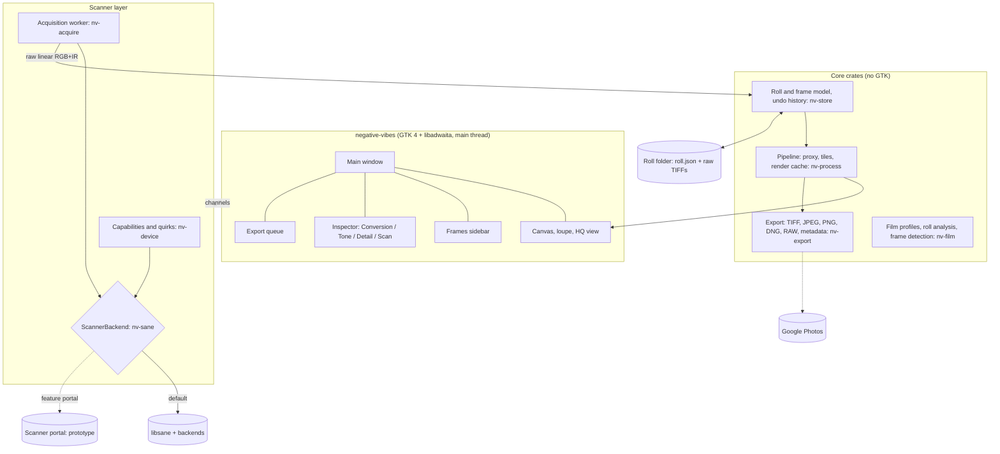
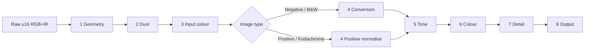

# Negative Vibes: how it works

A GNOME application for scanning colour and black-and-white negatives and slides,
on any film-capable scanner that SANE supports.

This document describes the application as it is. It explains what the parts are, why they
are shaped that way, what has been checked and what has not. For installing and using it,
see the [README](README.md) and the help pages in `help/`. The original plan, written before
any code existed, is kept as [`docs/design-history.md`](docs/design-history.md).

| | |
|---|---|
| Describes | The working tree as of 2026-10-16, including the scanner portal prototype |
| Requirements | [`negative-scanner-features.md`](negative-scanner-features.md) (the feature list, cited here as **F§n**) |
| Reference scanner | Plustek OpticFilm 8200i, USB `07b3:1825` (Genesys GL128), with the [`plustek8200i`](https://github.com/cschalle/OpticFilm8200i-sane) SANE backend |
| Application ID | `io.github.cschalle.NegativeVibes` |
| UI guidelines | GNOME Human Interface Guidelines, libadwaita patterns and widgets |
| Licence | GPL-3.0-or-later (§4.4) |

Section numbers are stable: source comments refer to them (for example "DESIGN.md §7.4"),
so a section keeps its number when its text changes.

---

## Contents

1. [Goals and non-goals](#1-goals-and-non-goals)
2. [Design principles](#2-design-principles)
3. [Architecture](#3-architecture)
4. [Technology choices](#4-technology-choices)
5. [Scanner layer: SANE, any device](#5-scanner-layer-sane-any-device)
6. [Data model and storage](#6-data-model-and-storage)
7. [Image pipeline](#7-image-pipeline)
8. [User interface](#8-user-interface)
9. [Feature coverage](#9-feature-coverage)
10. [Status](#10-status)
11. [Testing](#11-testing)
12. [Repository layout and conventions](#12-repository-layout-and-conventions)
13. [Risks and open questions](#13-risks-and-open-questions)

---

## 1. Goals and non-goals

### Goals

- **Turn film into finished digital images** in one application: preview, frame, convert
  negatives, correct, remove dust, sharpen, and export, for single frames and whole rolls.
- **Work with every SANE scanner that can scan film.** The app discovers what a device can do
  (transparency source, infrared, resolutions, exposure) and adapts. The OpticFilm 8200i is
  the reference device and the only one tested; the code does not special-case it. What SANE
  cannot report goes in a data file (§5.5).
- **Feel like a GNOME application.** libadwaita widgets, adaptive layout, the HIG's writing
  style, keyboard access, and no floating tool windows.
- **Non-destructive and reproducible.** Keep the raw linear scan (with infrared when the
  scanner has it) and a stack of settings. Every output can be re-rendered later, which gives
  the "HDRi RAW, process later" workflow (F§3) for free.
- **Correct on large data.** A 7200 dpi frame is 10368 × 7755 px, 482 MB as 16-bit RGB. The
  pipeline stays responsive and bounded in memory at that size (§7.2, check H8 in §11.4).

### Non-goals

- Flatbed document scanning (GNOME Document Scanner does that well). Reflective scanning of
  photo prints is not prevented, but not a priority.
- Camera scanning (DSLR plus light source). "Open Raw Scans" accepts such files, but there is
  no tethering.
- A general photo editor. Tools exist to finish a scan, not to retouch.
- Printing, descreening, PDF output and line art (F§6, F§10 mark them skip).
- Running on Windows or macOS.

---

## 2. Design principles

These come from a survey of SilverFast (F§1, F§17) and from the driver work (F§18–21).

1. **Hardware settings and software settings are visibly different.** Resolution, infrared,
   exposure, multi-sampling and scan area need a new scan. Everything else only re-renders.
   The Scan page groups the former; the other pages are the latter. SilverFast hides this
   distinction, which F§17 calls its biggest usability problem.
2. **The roll is the unit of work, the frame is the unit of output.** Settings live at roll
   level, with per-frame overrides (an idea taken from NegPy, F§19.5). Film base, film stock
   and conversion baseline are roll-wide by default, so frames from one roll match.
3. **Ask the driver for raw, linear data.** The app turns off driver-side gamma, inversion,
   auto white balance, sharpening and dust removal where it can, and does that work itself,
   where it can be controlled and undone. Exceptions are recorded per device (§5.5).
4. **Never block the UI.** Scanning, rendering and export run off the main thread. The
   interface shows progress and can cancel.
5. **Degrade gracefully.** No infrared: software dust removal instead. No exposure control: no
   multi-exposure, but multi-sampling still works. No scanner at all: open raw scans and keep
   working.
6. **Measurable quality.** Processing steps have tests on synthetic data and on real scans of
   a reference frame (§11).

---

## 3. Architecture



### 3.1 Components

| Crate | Responsibility |
|---|---|
| `nv-sane-sys` | Raw bindings to libsane, generated by bindgen against the installed headers. |
| `nv-sane` | Safe wrapper: `Session`, `Handle`, option descriptors and values, frame parameters, start/read/cancel. Defines the `ScannerBackend` and `ScannerHandle` traits that everything above it uses (§5.1). |
| `nv-sane-portal` | A `ScannerBackend` that talks to the proposed scanner portal over D-Bus instead of loading libsane (§5.9). Optional. |
| `nv-device` | The capability model built from option descriptors plus the quirks file (§5.2, §5.5), and the acquisition plan for a scan. |
| `nv-acquire` | The acquisition worker thread: preview and scan, frames, progress, cancel, multi-sample and multi-exposure, RGB+IR. Picks the backend (libsane or portal). |
| `nv-image` | Image buffers: `FrameBuf`, 8 or 16 bit, strided. |
| `nv-process` | The pipeline stages (§7), the editing proxy, tiled full-resolution rendering, the settings model with its roll and frame scopes. |
| `nv-film` | Film profiles (built in, user library, builder), frame detection. |
| `nv-store` | Roll folders, `roll.json`, raw TIFF/PNM/DNG reading and the strip-streaming raw writer. |
| `nv-export` | Output colour spaces and ICC profiles, naming templates, the TIFF/JPEG/PNG/DNG encoders, XMP and EXIF metadata, resizing. |
| `nv-calibrate` | IT8 scanner calibration: runs ArgyllCMS as subprocesses. |
| `nv-gphotos` | Google Photos upload: OAuth with PKCE, the add-only Photos Library API. |
| `nv-cli` | `probe`, `scan`, `render`, `calibrate`: the same code, headless, for tests and batch use. |
| `nv-portal-proto` | A test double for the scanner portal, with its checks. Not part of the application (§5.9). |
| `negative-vibes` (`src/`) | The application: widgets, actions, preferences, the render scheduler, the export queue. |

The core crates have no GTK dependency. They are tested headless, and `nv-cli` shares them.

### 3.2 Threads

| Thread | Work |
|---|---|
| Main (GTK) | UI only. Never calls SANE or processes full-resolution pixels. |
| SANE worker (`nv-sane-worker`) | Every libsane call, serialised. SANE backends are not guaranteed to be thread-safe, and cancelling works because one thread owns the read. The worker is joined when it is dropped, because `sane_exit` unloads the backends and racing the process exit aborts inside a backend destructor. |
| Render and I/O | GLib's thread pool through `gio::spawn_blocking`: preview renders, thumbnails, raw reads and writes. One preview render runs at a time; edits that arrive meanwhile collapse into one more render with the latest parameters, so a dragged slider never queues work. |
| Tiles | `std::thread::scope` inside `nv-process::tiles` and the TIFF writer: full-resolution tiles render in parallel for the 1:1 view and for export. |
| Export (`nv-export`) | One thread runs the export queue in order, so an export never stalls rendering. Google Photos uploads run here too. |

Threads talk through `async-channel`, and the UI receives updates as futures on the GLib main
context, so no locks are held on the main thread. Cancellation is a shared flag, checked
between SANE reads and between export bands.

---

## 4. Technology choices

### 4.1 Rust with gtk4-rs and libadwaita-rs

| Need | Choice | Notes |
|---|---|---|
| Language | Rust 1.88 or newer, edition 2024 (let chains) | 16-bit images of hundreds of megabytes need native speed and memory safety. |
| UI toolkit | GTK 4 and libadwaita through `gtk4` 0.9 and `libadwaita` 0.7 | Meson requires GTK 4.14 and libadwaita 1.4 or newer; the Rust bindings are built with the GTK 4.10 and libadwaita 1.4 API. |
| UI definitions | Written in code | No Blueprint or `.ui` files: the window is built in Rust (`src/window.rs` and `src/window/`). |
| Build | Meson wrapping Cargo (`build-aux/meson/cargo-build.sh`) | Meson installs the desktop file, AppStream metadata, icon, help pages, quirks file and the GSettings schema. |
| SANE | Own `nv-sane-sys` and `nv-sane` | No maintained Rust crate covers multi-frame acquisition and option metadata the way the app needs. |
| TIFF | The `tiff` crate reads; a TIFF writer in `nv-export` writes | The `tiff` crate (0.9) corrupts a compressed image written as strips, which is why the app writes its own container (Deflate and LZW through `flate2` and `weezl`). |
| JPEG, PNG | `jpeg-encoder`, `png` | ICC profiles embedded. |
| DNG | Own reader (`nv-store::dng`) and writer (`nv-export::dng`) | Linear DNG; the reader follows the SubIFD and bounds-checks every offset. |
| Colour management | In code | Output ICC profiles are written by `nv-export::icc`; scanner (input) profiles are read by `nv-process::input` into a matrix and curves. There is no lcms2 dependency. |
| Metadata | In code | XMP and EXIF packets are built by `nv-export::metadata` and `nv-export::exif`. There is no gexiv2 dependency. |
| Registration | Edge correlation, in `nv-process` and `nv-acquire::passes` | No FFT dependency. |
| Parallelism | `std::thread`, GLib's thread pool | No rayon. |
| IT8 calibration | ArgyllCMS (`scanin`, `colprof`) as subprocesses | Optional at run time. |
| Google Photos | `ureq` (blocking), `oo7` for the keyring | The refresh token lives in the keyring; in a Flatpak that is the Secret portal. |
| Scanner portal prototype | `zbus` | Only in the optional crates (§5.9). |
| Help | Mallard pages for Yelp in `help/C/` | |
| Translations | gettext setup in `po/`; no translations yet | |
| Packaging | Flatpak (GNOME runtime 49), published by GitHub Actions; native Meson install | |

### 4.2 Alternatives considered

- **C with GObject.** Matches the SANE backend and GNOME's core libraries, but a
  multi-threaded image pipeline in C is where memory bugs live.
- **Python and PyGObject on NegPy's core.** It would reuse a lot of film-conversion science,
  but NegPy is an alpha with no stable core API, its dependencies (numba, OpenCV, wgpu,
  onnxruntime) are heavy for a Flatpak, and Python makes a 7200 dpi memory budget hard to hold.
  NegPy stays a design reference: roll analysis, roll and frame scopes, density-space
  conversion, crosstalk matrices and dust methods are adopted as ideas in §7. Both projects are
  GPL-3, so porting a specific algorithm with attribution remains possible.
- **GEGL as the pipeline.** Its Rust bindings are not mature, and the tile, proxy and cache
  needs here are narrow enough to own.

### 4.3 Application identity

- Name: **Negative Vibes**.
- Application ID: `io.github.cschalle.NegativeVibes` (the GitHub account that owns the
  repository, as Flathub requires). Development builds use the `.Devel` ID.
- Icon: the scalable SVG in `data/icons/hicolor/scalable/apps/`, a traced version of the
  original picture kept in `data/icons/source/`. A designer's redraw would be cleaner.

### 4.4 Licence

**GPL-3.0-or-later.** The SANE backend stays GPL-2.0-or-later and separate: the app only talks
to it through libsane, a dynamic and stable C interface (or through the portal, §5.9), so the
two licences never meet in one binary.

---

## 5. Scanner layer: SANE, any device

### 5.1 libsane binding and the backend traits

- libsane is linked dynamically, so the `dll` meta-backend and every installed backend are
  available, including out-of-tree ones.
- `nv-sane` wraps `sane_init`, `sane_get_devices`, `sane_open`/`close`, option descriptors and
  `sane_control_option` (with the `SANE_INFO_*` flags returned as `SetInfo`),
  `sane_get_parameters`, `sane_start`, `sane_read` and `sane_cancel`.
  `Handle::set_option` converts between integer and fixed-point values by the option's type: a
  caller that passes an integer for a fixed-point option (the SANE test backend's resolution)
  would otherwise write the integer's bits.
- Two traits sit on top, and the rest of the app uses only them:
  - `ScannerBackend`: `get_devices`, `select_devices` (a no-op with libsane; the portal's
    dialog with the portal), `open`.
  - `ScannerHandle`: options, `get_parameters`, `start`, `read`, `cancel`.

  Neither requires `Send`: libsane objects stay on the worker thread, and any other backend is
  held to the same rule.
- `DeviceInfo` carries `name` (what `open` takes), `backend`, `vendor`, `model` and `kind`.
  Quirks are matched on `backend` and `model`, never on `name`: the name changes when the
  scanner is re-plugged (`plustek8200i:libusb:003:007`), and through the portal it is an opaque
  id.
- Devices are listed with `local_only = true` (network backends are slow). Webcams, which SANE
  offers through its `v4l` backend, are recognised by `DeviceInfo::is_webcam` and left out.
  libsane also types webcams, and its own test backend, "virtual device"; the worker hides that
  type unless `NV_SANE_ALLOW_VIRTUAL` is set (for testing against the test backend).

### 5.2 Capability model

The app decides what to show from **capabilities**, not backend names. `DeviceCapabilities`
(in `nv-device`) is built from the option descriptors and refined by the quirks file.

| Capability | From | Used for |
|---|---|---|
| Film source | A `source` option with a transparency-like value, or a film-only device | Selecting transmissive mode |
| Infrared style | Mode values (`Color+Infrared`, `Infrared`) or an RGBI frame; `MultiFrame`, `Rgbi`, `SeparateScan` or none. The quirks file overrides | Dust removal, HDRi RAW |
| Bit depths | The `depth` option; 16 preferred | Always scan 16-bit when offered |
| Resolutions | `resolution` word list or range, or `optical-dpi` from the quirks file | The Scan page's resolution list |
| Scan area, film window | `tl-x` … `br-y`, or `film-window-mm` | Frame rectangles, crops |
| Preview option | `preview` | Faster previews |
| Exposure option | `exposure*` (the 8200i: a factor 1.0 to 4.0) | Multi-exposure |
| Holder | Quirks, else the size of the scan area (§5.7) | Roll workflow |
| Streaming progress | Quirks (`streaming-progress`) | A real progress bar |
| Neutralise list | Quirks | Options turned off before a scan (§5.4) |

There is no page that shows every SANE option: only what the app uses is exposed. A scanner
button as a trigger, calibration actions and analogue gain are not implemented.

### 5.3 Acquisition

An acquisition plan is one or more SANE scans with option settings, plus a recipe to combine
them:

| Plan | Scans | Combine |
|---|---|---|
| Plain | 1 | |
| RGB + IR, one acquisition | 1 (an RGB frame with `last_frame = false`, then a gray IR frame; or one RGBI frame) | Split planes |
| Multi-sample ×N (1 to 8) | N identical scans | Align each to the first, average |
| Multi-exposure | The same number of passes again at a longer exposure (×1.2 to ×4) | Align, then merge in linear light |

Frame handling covers the formats SANE allows: RGB and gray at 8 or 16 bit, three-pass red,
green and blue frames, the multi-frame RGB + IR sequence, and RGBI. `Parameters.lines` is an
`Option`, for scanners that do not know the height. Parameters are always read after
`sane_start`.

**Multi-frame scans.** After a frame with `last_frame = false` the next frame is started with
`sane_start` alone, with no `sane_cancel` in between: on a real driver a cancel throws the scan
away and the first frame comes again.

**Streaming.** Lines go from `sane_read` into the frame buffer and, for a scan saved to a
roll, out to the raw file strip by strip (§6.3). Progress is bytes received over the expected
size; with a driver that delivers data during the scan the bar is real, otherwise it pulses.

**Cancel.** Setting the flag makes the worker call `sane_cancel` between reads. On the 8200i,
Stop at 30% of a 1200 dpi scan returned in 0.07 s and the next scan succeeded (check H4).

**Passes.** Multi-sample and multi-exposure are limited to 3600 dpi and below, because the sums
need memory (about 1.3 GB at 3600 dpi). Each pass is aligned to the first by correlating
edges on a full-resolution crop of the middle, to a fraction of a pixel, and applied by
bilinear resampling; the scanner's position jitters by up to about 1.8 pixels from pass to pass
at 1200 dpi. The long exposure of the 8200i is not a clean multiple of the normal one (factor
2.5 measured 2.56 to 2.62, varying by channel, with an offset near −270 counts), so the merge
fits a quadratic from the long sample to the normal one per channel, from the picture itself,
and weights a long sample at 0.62 per unit of exposure factor, and at nothing as it nears
clipping. On the 8200i at 600 dpi four samples halve the noise exactly (121 to 61 counts rms);
multi-exposure cuts noise in the darkest tenth to 0.55 of a single scan's.

### 5.4 Raw settings

Before a scan the worker sets, where the option exists: mode Color (or Color+Infrared), depth
16, the resolution, the scan area, `preview` for previews, and every option on the device's
neutralise list off. For the 8200i that is `auto-wb` and `ir-clean`. The driver log of an app
scan confirms `ir-clean` 0, `auto-wb` off, depth 16 and mode Color (check H6).

### 5.5 Device quirks file

What cannot be detected goes in `data/devices.toml`, matched on backend and model. A file at
`$XDG_CONFIG_HOME/negative-vibes/devices.toml` **replaces** the shipped one (it is not merged
with it). The fields are described in the file's header. For the reference scanner:

```toml
[[device]]
match = { backend = "plustek8200i", model = "OpticFilm 8200i" }
film-window-mm = [36.5, 27.2]
holder = "manual-advance"
optical-dpi = [300, 600, 1200, 2400, 3600, 7200]
recommended-dpi = 3600
ir = "multi-frame"                 # Color+Infrared: RGB frame, then IR frame
ir-registered = true               # both passes share geometry; no alignment needed
exposure-option = "exposure"
neutralise = { "auto-wb" = false, "ir-clean" = false }
preview-dpi = 600
streaming-progress = true
```

The app works without an entry: detection (§5.2) gives a usable default. Scanners other than the
8200i have not been tested, so there are no other entries.

### 5.6 Registration of separate passes

Separate infrared scans, multi-sample and multi-exposure need aligned passes. The offset is
found by correlating edges (coarsely over the search range, then finely, then to a fraction of a
pixel with a parabola through the peak) and applied by bilinear resampling; offsets under a
quarter of a pixel are ignored. The search range is a preference (default 20 px). For infrared
the offset is measured on the proxy and frozen, so every tile uses the same one. It is found to
a few tenths of a pixel on synthetic offsets up to 12 px, and finds essentially none on the
8200i's real scans, which agrees with it delivering registered planes (`ir-registered`).

### 5.7 Holders: multi-frame preview versus manual advance

- **Multi-frame preview** (flatbeds with film guides, strip feeders): one preview shows several
  frames; frame detection finds them.
- **Manual advance** (OpticFilm 8100/8200i/8300i): the scanner sees one frame window and the
  holder is pushed by hand. Scan All becomes a guided loop: scan, a banner "Move the holder to
  the next frame" with **Scan Next Frame**, then preview and scan again.

The quirks file declares the kind; without an entry a device whose full scan area is smaller
than 40 × 30 mm is treated as manual advance. Pressing a scanner button to continue the loop is
not implemented (the backend exposes no button).

### 5.8 No scanner: open raw scans

**Open Raw Scans…** imports 16-bit linear scans (TIFF, PNM, DNG; a `.pnm` with a `-ir.pgm` next
to it reads as a four-channel scan, which is what `irscan` and `nv-cli scan` write) into a new
roll. Every tool except acquisition works, which keeps the app useful without a scanner and
makes the pipeline testable with fixtures.

### 5.9 Scanner access through a portal (prototype)

A Flatpak app needs `--device=all` and the SANE backends inside the sandbox to scan, and the
user cannot see or revoke that access. Printing has a portal; scanning does not. A proposal for
`org.freedesktop.portal.Scanner`, written to go upstream to xdg-desktop-portal, lives in
[`flatpak-scanner-portal`](https://github.com/cschalle/flatpak-scanner-portal), a repository of
its own, with the draft D-Bus interface files, the patches and the conformance tests.

The app is the test bed. It is a prototype, off by default:

- **`nv-sane-portal`** implements `ScannerBackend`/`ScannerHandle` over the portal.
  `nv-acquire` uses it when built with `--features portal` and run with
  `NV_SCANNER_BACKEND=portal` (`NV_PORTAL_BUS_NAME` names the portal; the default is the
  desktop's, `org.freedesktop.portal.Desktop`, and the prototype is reached by naming it).
  With the feature off, that variable is an error, never a silent fallback.
- **`nv-portal-proto`** is a stand-in for the real portal, implementing the draft interface
  over libsane on its own bus name, with the permission store and the dialog stubbed.
- With the portal the list of devices is only what the user has granted, so an empty list
  usually means "none chosen yet": the page then leads with **Choose Scanner…** (also in the main menu), which asks the
  worker to show the portal's dialog (`select_devices`) and probe again. The app passes no
  window identifier yet, so the real portal's dialog would not be attached to its window.

A second application, GNOME Simple Scan, has been ported to the draft and has scanned on the
8200i from a sandbox (patch outside this repository); what it needed that Negative Vibes did
not is in `docs/PROPOSAL.md` of flatpak-scanner-portal ("What a second application found"): automatic
option values, a frame number on `FrameEvent`, and the SANE device type.

What is checked is in §11.4 and in `docs/PROPOSAL.md` of flatpak-scanner-portal. The prototype is not
used unless asked for, and nothing in the release Flatpak depends on it.

**Sandbox test.** `build-aux/io.github.cschalle.NegativeVibes.PortalTest.json` builds the app
with `-Dportal=true` as the Devel app ID, with `NV_SCANNER_BACKEND=portal` and without
`--device=all` and `--share=network`; its only bus access is `--talk-name` for
`org.freedesktop.portal.Desktop` and the prototype's name (the manifest sets
`NV_PORTAL_BUS_NAME` to it). The scenario script and the hardware cancel check are installed in
`/app/share/portal-test`. Run with `flatpak-builder --run`. The results are in §10.

**Portal build.** `build-aux/io.github.cschalle.NegativeVibes.Portal.json` is the same build for
a desktop that has the scanner portal: no test scripts, no bus access beyond the portal's own
name, and the portal's default bus name. It is built into a local repository and installed as
the `portal` branch of the Devel app ID.

---

## 6. Data model and storage

### 6.1 Objects

```text
Roll
├─ id, name, created, notes
├─ settings: Settings              roll-wide defaults for every frame
└─ frames: [Frame]
     ├─ id, index, label, state (previewed, scanned, exported), keep/reject
     ├─ geometry: crop rectangle, orientation (90° steps, mirror), straighten angle
     ├─ raw: RawRef                the raw file(s) in the roll folder
     └─ overrides: Settings        only the fields that differ from the roll
```

The effective settings of a frame are the roll's with the frame's overrides applied. The
inspector has a **Whole Roll / This Frame** switch; with Whole Roll selected, an edit changes
every frame that has no override. Each frame has an undo history that remembers which scope
every step was made in, so undoing a roll-wide edit puts the roll back; it is saved with the
roll (§6.2).

`Settings` (in `nv-process::settings`) holds the image type (Negative, Positive, B&W Negative,
Kodachrome), the film profile, conversion, tone, colour, detail and dust parameters, and the
scan settings (resolution, infrared, samples, exposure, the area). The hardware ones need a
new scan; the rest only re-render.

### 6.2 Roll folders

A roll is a directory, so it can be backed up, synced and opened later:

```text
Roll 2026-10-06 21-04-12.nvroll/
├─ roll.json              the model above ("schema": 1; missing fields take defaults)
├─ raw/
│  ├─ frame-01.tif        the scan: 16-bit linear RGB, infrared as a 4th sample
│  └─ frame-01.prev.tif   the preview scan the frame was cut from
├─ thumbs/                small thumbnails (rebuildable)
├─ history.json           undo history, the last 30 steps per frame
├─ exports.json           what was exported, where
└─ google-photos.json     the roll's album (only if uploaded)
```

New rolls are made in `~/Pictures/Negative Vibes/` (the Pictures folder of the user), named from
the date and time; **Open Roll…** opens one from anywhere. Exports go to the output folder from
the preferences (default `~/Pictures/Scans/<roll>`), not into the roll. Rolls save themselves
(§6.4).

### 6.3 Raw file format

The raw store is also the **HDR RAW** (48-bit linear RGB) and **HDRi RAW** (64-bit RGB + IR)
export, so "save raw, process later" is not a separate feature. It is a strip-based TIFF written
by `nv-export`, 16 bit per sample, Deflate with the horizontal predictor, infrared as a fourth
sample (`ExtraSamples` unspecified). No ICC profile is embedded, because the data is device
RGB. Exporting the raw is a byte-for-byte copy (`copy_raw`).

Because the file is strip-based, a 7200 dpi frame is never held whole just to look at it:
`RawReader::proxy` reduces it a strip at a time, and `RawReader::region` reads only the strips
a block needs. Anything else (PNM, DNG, tiled TIFF) is read whole.

### 6.4 Formats and locations

| What | Format | Where |
|---|---|---|
| Preferences | JSON, written as each control changes | `$XDG_CONFIG_HOME/negative-vibes/` |
| Rolls | JSON, `"schema": 1`; older files get defaults for new fields | roll folders |
| Film profiles | One JSON file each, validated on import | built in; user profiles in `$XDG_DATA_HOME/negative-vibes/film/` |
| Metadata presets (IPTC) | One JSON file each | `$XDG_DATA_HOME/negative-vibes/metadata/` |
| Scanner (input) ICC profiles | `.icc` | `$XDG_DATA_HOME/negative-vibes/profiles/` |
| Device quirks | TOML | shipped `devices.toml`; override `$XDG_CONFIG_HOME/negative-vibes/devices.toml` |

Preferences are plain JSON, not GSettings, so the app needs no installed schema to run from a
source tree. The GSettings schema in `data/` is installed but not what the preferences use.

**Auto-save.** Roll changes are written 2 s after the last edit and when the window closes,
atomically (to a temporary file, then renamed). A roll has no "unsaved changes" state, as the HIG
prefers.

---

## 7. Image pipeline

### 7.1 Stages

All processing after acquisition is a fixed sequence of stages, each with a parameter struct;
inactive stages are skipped.



| # | Stage | Contents |
|---|---|---|
| 1 | Geometry | Crop to the frame, rotation and flip in 90° steps, fine straighten (−15° to +15°, enlarged by the least amount that fills the frame) |
| 2 | Dust | Infrared or software detection, repair, masks; Off / Correct / Mark |
| 3 | Input colour | The scanner (IT8) profile, applied to slides before normalising. Negatives ignore it: their colour comes from the film profile |
| 4 | Conversion | Film base, density inversion, range, dye gamma alignment, crosstalk, colour cast removal, exposure and print curve; or positive normalisation |
| 5 | Tone | Auto levels, levels on a histogram, master and per-channel curves, midtone, pipettes (film base, black, grey, white) |
| 6 | Colour | Saturation, shadows/midtones/highlights colour wheel, restore faded colour, selective colour (six ranges), colour-to-grey |
| 7 | Detail | Unsharp mask, grain and noise reduction, local contrast |
| 8 | Output | Output colour space (sRGB or Adobe RGB) with its transfer curve, 8 or 16 bit |

The tone curves work in a gamma-2.2 encoding and the final encode uses the true sRGB curve, so
the preview and an sRGB export agree.

### 7.2 Rendering: proxies, tiles and caching

- **Editing proxy.** A scan is decoded once and box-reduced to about 2 Mpx
  (`DEFAULT_PROXY_PIXELS`). The canvas renders from it on a worker thread; edits that arrive
  while a render runs collapse into one more render with the latest values.
- **Render cache.** The converted picture (the output of stage 4) is kept, so tone, colour and
  curve edits skip it.
- **Tiles.** Full-resolution work (the 1:1 view, the loupe, export) is rendered in 512 × 512
  tiles, with a margin per stage for neighbourhood operations (dust 24 px, unsharp mask three
  radii, noise reduction 5 px). `tiles::freeze` fixes what the pipeline measures on the whole
  picture (film base, density range, colour axis, a positive's range, the local-contrast grid)
  from the proxy, after which tiles render independently and join exactly: tiled and
  whole-picture renders are tested bit for bit (with dust, which measures its own lamp surface,
  within 1% of samples by more than 8 levels). `TileCache` keeps finished tiles inside a
  memory budget.
- **Export** renders in tile-high bands and streams them to the encoder, and renders only the
  part of the scan each band of a turned or straightened picture comes from, so the memory cost
  stays one band.

Measured in release on a synthetic 7200 dpi frame (10368 × 7755), 16 threads, warm file cache:
a first render from the proxy 0.13 s, a tone-only render 0.06 s, a first 1600 × 1000 view at 1:1
0.26 s, a full-frame render for export 0.85 s; a 16-bit Deflate TIFF export in 3.7 s. With
sharpening and Medium noise reduction the export takes 19 s. (`cargo test --release … --ignored
--nocapture` in `nv-store`, `nv-process` and `nv-export`.)

### 7.3 Previewing filters at 1:1

Two views show filters at the scan's own resolution:

- **Loupe:** 360 × 360 pixels around the pointer, every filter at full quality, rendered off the
  UI thread once the pointer rests; a big scan is read from disk for just that block.
- **HQ view:** the region on screen at the scan's resolution with every filter, when zoom is 1:1
  or more, laid over the canvas. It is off while a straighten angle is set.

Both need a scan at the final resolution. A preview-then-scan-at-final-resolution step that
would give a 1:1 view from a low-resolution preview is not built.

### 7.4 Negative conversion

The conversion is in **density space** with a measured film base (the SilverFast parameter model
of F§4.2 and NegPy's density approach of F§19.4):

1. **Linear transmission.** Raw RGB normalised so the scanner's open light is 1.0. The 8200i
   driver calibrates to that per scan; the file maximum stands in for other devices. A stored
   open-light reference is not implemented.
2. **Film base `b_c`.** Auto, measured from the border of the preview or scan, where the film
   rebate is (inside the frame's own region when one image holds several frames); **Pick Film
   Base** with the pipette; or the roll's median of the frames' estimates, the default scope. *2a.* Dye crosstalk: when the film
   profile carries a non-identity 3 × 3 matrix, it is applied here.
3. **Density above base:** `D_c = log10(b_c / T_c)`, clamped at 0. This divides out the orange
   mask without a colour-specific step.
4. **Range.** Per-channel maximum density from a high percentile of the density inside the
   frame's region (not the surround), with **Tolerance** controlling the clipped fraction.
5. **Dye gamma alignment and colour cast removal (CCR).** `D'_c = k_c · D_c`, so the three
   channels share one neutral axis. `k_c` comes from the film profile, or is solved from the
   picture by a trimmed least-squares fit of red and blue density against green.
   Auto does not guess a colour cast beyond that: equalising channel medians turned the tulip
   test wall blue-green because the scene is mostly red and green.
6. **Print curve.** Normalised density goes through an S-curve (the profile's toe and shoulder),
   with **Exposure** as a shift along log exposure and a contrast slope.
7. **B&W negatives:** a single density channel from the weights of the chosen colour-to-grey
   preset, no mask. Chromogenic B&W (XP2, BW400CN) takes the colour path, then converts to grey.
8. **Roll analysis.** **Analyse Roll** measures each frame inside its own rectangle and fixes the
   roll's median film base, density range and colour axis as roll-wide values, so every frame
   starts from the same conversion.

**Film profiles** (`nv-film`) are an open JSON format (id, vendor, name, ISO, kind, base,
gamma, maximum density, crosstalk, curve, and `measured_on`). Built in: Generic colour negative,
Generic B&W negative, Generic positive, and four named stocks (Kodak Portra 400, Kodak Gold 200,
Fuji Superia 400, Kodak T-Max 400). **The four named stocks are starting points, not
measurements** (their `measured_on` is empty). **Create Film Profile…** builds a profile from a
scan of unexposed base and an evenly stepped grey wedge exposed on the same film (base from the
base, dye gammas from a log-log fit against green, maximum densities from the densest usable
step, toe and shoulder from the response's slope), and refuses unsuitable scans with the reason.
It cannot tell crosstalk from a grey wedge, so that stays at identity. User profiles can be
imported, exported and deleted; shipped ones can be neither replaced nor deleted. A profile
measured on one scanner is valid on another only through the scanner profile, so profiles record
their device.

### 7.5 Dust removal

**Infrared (stage 2).** The infrared plane is fitted, robustly and jointly, to a degree-4
surface (the lamp's falloff) plus the ghost of the picture's red density (cyan dye absorbs
infrared). What lies well below the fit, by a margin set from the plane's own noise, is a
candidate; candidates are joined (eight-way, since a hair is a thin diagonal), kept if
plausibly small, grown to a disc, and repaired from their surroundings in log transmission,
working in from each mark's edge. Small marks get a smooth fill; marks over 30 pixels (hairs,
scratches) are filled by copying the best-matching nearby patch, brought to the local
brightness and colour, so the grain runs through the repair; blotches over 6000 pixels are
smoothed rather than searched. Modes are Off, Correct and Mark (magenta, colour is a
preference); **Detection** 1 to 20 sets the margin; **Defect Type** is Dark, Bright or Both
(an emulsion scratch is bright in the plane). The infrared plane is registered to the colour
first (§5.6).

**Software (SRDx-style).** A morphological top-hat on log transmission finds small dark or
bright specks, keeping only compact marks (a long thin mark is the picture's own detail), with
the same filtering and repair. It is the tool for silver B&W negatives and for scanners without
infrared. On the B&W test negative it still marks some sunglass reflections and glass
highlights at the default; that is its known limit.

**Which film.** Silver B&W film blocks infrared, so dust removal defaults to Off for B&W
negatives. Kodachrome's dyes block infrared like the picture, so its dust is always looked for in
the colour.

**Brush masks.** Three canvas tools: **Protect** (leave the picture alone here: stars,
eyelashes), **Heal** (repair here, whether or not anything was detected, and with no infrared)
and **Unmask**. A stroke is stored as points in fractions of the whole scan plus a radius, so it
means the same at any zoom, in a tile, in the loupe and in an export, and follows the picture
when it is rotated. Strokes belong to the frame whatever scope is selected, are saved in
`roll.json`, and are one undo step each.

### 7.6 Colour management

- **Input.** A scanner profile built with **Calibrate with IT8 Target…**: the raw scan is written
  as a plain 16-bit TIFF, ArgyllCMS `scanin` finds the patches and `colprof -qm -as` builds a
  matrix/curve profile, which `nv-process::input` reads back. The Colour group's **Scanner
  Profile** row picks one from `$XDG_DATA_HOME/negative-vibes/profiles/`. It applies to slides;
  negatives take their colour from the film profile. `nv-cli calibrate` does the same headless.
  Tested end to end against ArgyllCMS on a synthetic IT8 scan (average ΔE 1.6; the reader
  reproduces the target to a mean of 0.012 in linear sRGB). Not tested on a real IT8 target.
- **Output.** sRGB and Adobe RGB, as a matrix on linear light plus each space's own transfer
  curve, with ICC v2.4 profiles written in code and embedded in TIFF, JPEG and PNG; grey output
  embeds a gamma-2.2 profile. Adobe RGB export converted with our two profiles by an independent
  engine (ImageMagick/lcms) lands within 1.5 levels of our sRGB export.
- **Not implemented:** a display profile (colord), soft proofing, a wider output space, a
  colour-management switch.

### 7.7 Other tools

| Tool | Approach |
|---|---|
| Frame detection | On the overscan preview (`nv-film::detect`): holder against film, gaps along the film axis, inset by an auto frame inset. Unit-tested on synthetic strips |
| Auto adjust | Percentile black and white points and a midtone balance; no colour cast guess |
| Unsharp mask | On luminance of the sRGB-encoded picture: Amount %, Radius in pixels of the finished picture, Threshold in 8-bit levels; the radius shrinks with a proxy's reduction |
| Grain and noise | Non-local means on luminance and, harder, on colour differences; Light, Medium, Strong. Left out of the whole-frame preview and applied at 1:1 and in exports |
| Local contrast | Contrast-limited adaptive equalisation of brightness on an 8 × 8 grid, interpolated and blended by Effect; the grid is measured once on the whole picture |
| Densitometer | The 3 × 3 mean under the pointer: the scan's own values as percent transmission, then the rendered 8-bit values |
| Navigator | A "Map" popover shows the oriented picture with the visible part outlined |

---

## 8. User interface

### 8.1 How SilverFast's model maps to GNOME

| SilverFast (F§1) | Negative Vibes |
|---|---|
| Floating, dockable tool panels | One **inspector** sidebar with pages; tools are expander rows with an enable switch |
| Top toolbar (Prescan, Auto, …, Scan) | Header bar: **Preview**, **Scan** (a split button), the export queue, the main menu |
| Vertical tool strip | A canvas toolbar along the bottom: tool toggles, zoom, rotate and flip |
| Scanner status queue | An **export queue** popover from a header button, like Files' operations |
| Expert mode and WorkflowPilot | One window with progressive disclosure, plus the **Scan a Roll** guide (§8.5) |
| Preferences dialog with tabs | `AdwPreferencesDialog` with pages |

### 8.2 Main window

`AdwApplicationWindow` with an `AdwOverlaySplitView` for the frames sidebar (start) and another
for the inspector (end), the canvas between them, a header bar on top and the canvas toolbar at
the bottom. The Scan a Roll guide docks beside the picture in a third split view.

- **Header bar:** at the start the sidebar toggle, the film type and **Preview** (it becomes
  **Stop** while the scanner works); the title shows the app and the roll; at the end the main
  menu, the **Scan** split button (Scan Selected Frames, Scan All Frames, Scan Raw Only), Export,
  the export queue, Open Roll and the inspector toggle. Undo and redo are actions (Ctrl+Z,
  Ctrl+Y), not header buttons.
- **Frames sidebar:** frame thumbnails with number, state and keep/reject; Add Frame, Detect
  Frames, or **Next Frame** on a manual-advance scanner.
- **Canvas:** a custom widget with zoom and pan, the frame rectangle with handles (Shift locks
  the aspect), the pipettes, the densitometer, dust marks, brush strokes and the HQ view.
- **Inspector pages:** **Conversion** (film, film base, exposure, colour cast, straighten),
  **Tone** (levels histogram, curves, balance, pipettes), **Detail** (dust, unsharp mask, noise,
  local contrast, saturation, restore faded colour, colour wheel, selective colour, convert to
  grey, brush size and masks) and **Scan** (resolution from the device's own steps with the live
  size of the rectangle, infrared, samples, multi-exposure).
- **Bottom bar:** zoom, rotate and flip, the tool toggles (Frame, Pipette, Densitometer, Protect,
  Heal, Unmask, Loupe, HQ), Before/After and the Map.
- **Adaptive layout.** The window goes down to 360 px wide. Below 860 sp both side panels slide
  over the picture and the header bar keeps Preview, Scan and the menu; the title, Export, Open
  Roll and the inspector toggle move into the main menu.

### 8.3 States

| State | What the window shows |
|---|---|
| No scanner chosen | A status page "Choose a Scanner" with **Choose Scanner…** (the suggested action), and under "Without a scanner" **Open Raw Scans…** and **Open Roll…** |
| Scanner chosen, not answering | "Scanner Not Responding", naming the scanner, with **Try Again** (suggested) and **Choose a Different Scanner…**, then the same two buttons |
| Scanner found, no frames | "Insert Film and Preview" with a large **Preview** button and the film type toggle above it |
| Previewing, scanning | The canvas fills in as data arrives; Preview becomes **Stop**; the progress says which pass is running |
| Scan finished | A toast; on a manual-advance scanner the banner "Move the holder to the next frame" with **Scan Next Frame**. A scanned frame shows its scan, and *Show Preview or Scan* in the frame's menu swaps back to the preview |
| Scanner error | A dialog in plain words; scan, preview and roll errors wait for an answer, confirmations are toasts |
| Roll opened without its scanner | Everything works except acquisition |

### 8.4 The roll workflow

1. **Preview** the film: an overscan preview. Frames are detected (multi-frame devices) or the
   window becomes frame 1 (manual advance).
2. **Adjust** the first frame with **Whole Roll** scope so the settings become the roll's
   defaults; **Analyse Roll** measures the roll's film base and range.
3. **Scan** one frame, the selection, or all frames. A scan is taken inside the frame's own
   rectangle, so Scan All can scan frames cut from one preview. Each job acquires the raw into
   the roll and then exports it with the naming template; the next frame scans while the
   previous one exports.
4. **Re-export** at any time: change settings, then **Export** (Ctrl+E) re-renders from the raw.

### 8.5 Guided flow: Scan a Roll

The equivalent of WorkflowPilot (F§12), shown at start unless turned off. It docks beside the
main window and drives the same actions: **Film** (type including Kodachrome, a stock, the number
of frames), **Purpose** (Archive, Share, Print or Custom, each setting resolution, format, depth,
compression, colour space and size), **Preview**, **Look** (three rendered thumbnails: Lighter,
Neutral, Warmer), **Scan** (Scan All, with the manual-advance prompts) and **Done** (counts,
Open Folder, Scan Another Roll).

### 8.6 Dialogs

- **Preferences** (Ctrl+,): **General** (the guide at start, preview when the scanner is ready,
  export after each scan, open the exported picture, completion sound, the Mark colour, restore
  defaults), **Scanning** (preview and scan resolution, infrared by default, samples,
  multi-exposure, the two alignment limits), **Output** (format including DNG, name template,
  folder, colour space, embedded profile and metadata), **Colour** (the scanner profile new rolls
  start with, a shortcut to IT8 calibration), **Film Profiles** (your profiles: import, export,
  delete, create) and **Google Photos** (sign in and out, an Advanced section with a client ID and secret,
  for builds that have none baked in or for your own Google project).
- **Export** (Ctrl+E): preset (Archive, Share, Print, Google Photos), format (TIFF, JPEG, PNG,
  DNG, and the raw), depth, compression, quality, colour space, grey, profile, size (original,
  long edge, fit in a box, percent, named sizes; never larger than the scan), folder, name
  template with a live example, metadata, and *Send to Google Photos* with an album per roll.
- **Metadata** (Ctrl+I): the IPTC/XMP fields, with presets.
- **Calibrate with IT8 Target…**, **Create Film Profile…**, **Keyboard Shortcuts**, **About**,
  and **Help** (F1).

### 8.7 Keyboard shortcuts

`help/C/shortcuts.page` is the list, and the Keyboard Shortcuts window shows it too; a test
checks that every listed shortcut is bound. The conventions: GNOME's first (Ctrl+O, Ctrl+Z,
Ctrl+E, Ctrl+, , Ctrl+Q, F1), and keys the HIG reserves are not reused for SilverFast's meanings.

### 8.8 Writing, accessibility, translation

- Header capitalisation for titles and buttons, sentence case for descriptions and toasts, an
  ellipsis for actions that open a dialog, no SANE terms in the main UI ("Preview", not
  "Prescan"; "Scanner disconnected", not a status name).
- Icon-only buttons take the name of their tooltip, and the picture, histogram, levels, curve,
  wheel, overlay and navigator areas have names. Orca itself has not been run. Still
  pointer-only: the tone curve points, the levels handles (their numbers are in spin rows), brush
  strokes and the frame rectangle. The colour wheel works from the arrow keys.
- Dark and light styles, high contrast and large text have not been checked.
- All strings are meant to be translatable; `po/` has the gettext setup and no translation yet.

### 8.9 Headless hooks

For tests and scripted runs the app reads environment variables: `NV_AUTOSCAN=raw|scan|all`
(preview, scan, quit when done), `NV_AUTOSCAN_STOP=1` (press Stop at 30%), `NV_SAMPLES`,
`NV_LONG_EXPOSURE`, `NV_IMPORT_FILES` with `NV_EXPORT_DIR` (import and export through the queue),
`NV_OPEN_FILE`, `NV_OPEN_DIALOGS=1` (open every dialog to check it builds without GTK warnings),
`NV_WINDOW_SIZE=WxH`, `NV_DEBUG_MINWIDTH`, `NV_DEBUG_PASSES=dir`, `NV_KEEP`, `NV_DUST_VIEW`, and,
for the scanner layer, `NV_SCANNER_BACKEND`, `NV_PORTAL_BUS_NAME` and `NV_SANE_ALLOW_VIRTUAL`.
`NV_UPDATE_GOLDENS=1` regenerates the golden images (§11.1).

---

## 9. Feature coverage

Where the feature list (F§n) landed. *Done* means built and covered by tests or by a recorded
check; the hardware column of §10 says what has been tried on the scanner.

| Feature list | State |
|---|---|
| F§1 Layout | Done (inspector, bottom bar; no floating windows) |
| F§2 Device, preview, scan, batch, cancel | Done, including manual-advance Scan All and Stop |
| F§2 Infrared | Done (capture, registration, dust) |
| F§2 Multi-sample, multi-exposure | Done, up to 3600 dpi. Analogue gain: not done |
| F§2 Auto-preview at start, completion sound | Done (preferences) |
| F§2 Draft quality, three-line/shutter | Draft: the `preview` option is used for previews. Three-line/shutter: not done (the app has no page for arbitrary device options) |
| F§3 Image types | Done: Negative, Positive, B&W Negative, Kodachrome |
| F§3 HDR RAW, HDRi RAW | Done (the raw store, §6.3) |
| F§3 Colour-to-grey | Done, with standard photographic filter weights |
| F§4 Negative conversion, roll analysis | Done (§7.4) |
| F§4.1 Film profile library | Library and builder done; **no measured stocks yet** |
| F§5 Auto adjust, levels, curves, pipettes | Done. Scene presets: not done |
| F§5 Colour wheel, selective colour, ACR | Done |
| F§5.8 Densitometer | Partly: no pinned probes or mini-histograms |
| F§6 Unsharp mask, GANE, AACO | Done |
| F§6 iSRD-style and SRDx-style dust removal, masks | Done |
| F§6 1:1 and HQ preview | Loupe and HQ view done. Preview at scan resolution: not done |
| F§6 Descreening | Skip |
| F§7 Frames | Draw, detect, select, add, delete, duplicate, keep/reject, per-frame settings and rotate/flip done. Holder templates: not done |
| F§8 Rotate, flip, zoom, navigator, straighten | Done |
| F§9 Resolution, live file size, size presets | Done |
| F§10 Naming, folder, TIFF, JPEG, PNG, DNG, ICC, metadata | Done. IPTC-IIM block in JPEG: not written (XMP is) |
| F§10 PSD, JPEG 2000, PDF, print | Skip |
| F§11 Colour management | Input (IT8) and output spaces done; display profile, soft proofing, working-space choice not done |
| F§12 Guided mode | Done (§8.5) |
| F§13 Undo/redo, auto-save, presets | Undo and auto-save done; tool presets (USM and the like) and "save settings" files not done; memory limit and cache folder not done |
| F§15 Help | Sixteen Mallard pages, all drafts, no screenshots |
| F§18–21 Driver/app split | Done (§5.2–5.4) |
| Beyond the list | Google Photos upload; the scanner portal prototype |

---

## 10. Status

The application is feature-complete against §9 apart from the gaps listed there, and it runs on
the reference scanner. It has not been tested on any other scanner.

**Hardware results,** OpticFilm 8200i with the packaged `plustek8200i` backend, tulip negative
(2026-10-08), through `nv-cli scan` (the same acquisition worker as the app) and through the
app with its headless hooks:

| Check | Result |
|---|---|
| H1 App raw equals driver output | Pass: 600 dpi vs `scanimage`: dy +0.04 rows, dx 0, ncc 0.9996 |
| H2 Repeatability | Pass on alignment: dy 0.00, ncc 0.9997. The bands' lowest ncc is 0.9978, just under the 0.998 bar |
| H3 Progress is real | Pass: the driver climbs 31% at 10.4 s, 63% at 13.2 s, 94% at 16.0 s after about 7.6 s of positioning |
| H4 Cancel | Pass: Stop at 30% of a 1200 dpi scan returned in 0.07 s; the next scan aligned (dy +0.05) |
| H5 RGB + IR | Pass: dy 0, dx 0 between infrared and colour; IR median 46505 against the reference's 45855 |
| H6 Raw settings | Pass: `ir-clean` 0, `auto-wb` off, depth 16, mode Color |
| H7 Resolutions and size | 3600 dpi in 35 s: dy +0.22 rows against the 600 dpi reference, 0.02 over the ±0.2 bar. 7200 dpi in 73 s (482 MB): dy +0.17, within it |
| H8 Memory | A 7200 dpi import and export peaked at 3.0 GB; after streaming the writer and reader and showing big raws from a working-size copy it peaks at 1.3 GB |
| H9 Crop | Pass: a 50% × 60% area scan equals the same region of the full scan (dy +0.03, ncc 0.9991), one pixel up and left of the requested origin, which is the device's step size |

**The scanner portal prototype** (2026-10-16): the portal-backed `ScannerBackend` was run on the
8200i with `tools/portal-hw-check.sh` of flatpak-scanner-portal, against the installed `plustek8200i` 0.1.25 driver and the
reference frame (864 × 645 at 600 dpi, the size of the tulip fixture). The same frame was scanned
with libsane inside the app (direct), through the portal, and with `scanimage` as the reference.
All 23 checks of the last run passed, with the thresholds of §11.4:

| Check | Result |
|---|---|
| Capabilities and quirks, direct vs portal (`nv-cli probe`) | Identical, including `IR: MultiFrame` |
| H1 direct vs reference | dy −0.05 rows, dx 0, ncc 0.9998 |
| H1 portal vs reference | dy −0.05, dx 0, ncc 0.9998 |
| H1 portal vs direct | dy 0.00, dx 0, ncc 0.9999 |
| H2 portal repeat vs first | dy +0.02, dx 0, ncc 0.9999 |
| H3 portal progress | 50 steps from the first data, steady |
| H5 portal colour vs reference | dy −0.04, dx 0, ncc 0.9998 |
| H5 infrared aligned with colour, direct and portal | dy 0, dx 0 |
| H5 infrared level, direct vs portal | median 49660 against 49681 (0.0% apart) |
| H4 cancel at 30% of a 1200 dpi scan | Returned in 0.08 s |
| H4 scan after the cancel, same session, vs reference | dy −0.06, dx 0, ncc 0.9998 |
| Timeouts or DMA errors in the service log | None |

The scanner kept its USB address and its descriptors through the run. The portal path matches the
direct path to within sensor noise on every measure checked here.

**The portal from the Flatpak sandbox** (2026-10-16): the PortalTest build has no
`/dev/bus/usb` and no network. The portal scenarios (`scenarios.py`, SANE test backend, 30 checks)
passed from inside it, which covers reaching the bus name through the Flatpak D-Bus proxy, the
scan pipe's file descriptor passing through the proxy, signal delivery to the sandbox, per-connection
isolation and the lock. On the 8200i, with the service on a configuration that lists only
`plustek8200i`: the sandboxed `hw_cancel.py` cancelled a 1200 dpi scan at 30% in 0.08 s and the
300 dpi rescan completed; the GTK app itself, run with `NV_AUTOSCAN=raw`, found the scanner, made
a 432×322 preview and a 1728×1291 16-bit raw scan, and saved frame 1. The USB address and product
string were unchanged. Because the app only sees what the service offers, its probe never opened
the `genesys` entry (R10). After the second round of interface changes (automatic values, frame numbers, device type) the
hardware check passed again, 23 of 23. Not covered: the GUI cancel (`NV_AUTOSCAN_STOP`), the Choose Scanner…
button, an infrared scan from the app, and a real portal dialog.

Getting there took three runs. The first, with a private configuration, passed everything up to
the infrared scan and then exposed a bug in the prototype service: it cancelled between the
frames of a colour+infrared scan, so the 8200i delivered the colour frame again and again until
the run was stopped. That is fixed and has a regression test. The second run used the system SANE
configuration and was cut short when opening the stock `genesys` entry for the scanner reset it
(R10 in §13). The third, through a private configuration that lists only `plustek8200i` and with
the script stopping if the USB address changes, is the one above.

**Not verified.** The scanner's scan button is not used. The 2026-10-09 notes record several
dialogs and widgets as built and started but not clicked through (the Scan a Roll window, the
colour wheel, the loupe and HQ view, the navigator, the film profile dialog); this document does
not know whether that has changed since. A real slide, a real IT8 target,
a measured film stock and a real wedge scan have not been scanned. Google Photos upload has only
been run against a local stand-in server: it needs an OAuth client that does not exist yet.
DNG has been opened in darktable, not in RawTherapee or Lightroom.

**Known limits.** Multi-sample and multi-exposure stop at 3600 dpi. Software dust removal
marks some real detail on silver B&W film. The four named film profiles are not measured.
The app passes no window identifier to the scanner portal's dialog.

The per-slice build notes, with the measurements behind these results, are in
[`docs/design-history.md`](docs/design-history.md) (§10 there).

---

## 11. Testing

| Layer | Needs | Catches |
|---|---|---|
| 11.1 Unit and golden-image tests | fixtures in `tests/fixtures/` | pipeline maths, file formats, model logic |
| 11.2 SANE test backend | sane-backends | frame formats, option handling, cancel, progress |
| 11.3 Simulated film scanner | not built (see below) | |
| 11.4 Real hardware | the scanner | the driver contract: position, progress, cancel, IR, timing |
| 11.5 SilverFast comparison | the Windows VM harness | conversion and dust-removal quality against a reference |

`cargo test --workspace` runs the first two layers headless. CI runs it (§11.7).

### 11.1 Unit and golden-image tests

- Pipeline stages are tested on synthetic input with a known answer: inverting a synthetic
  negative made from a known positive and mask, a specked infrared plane giving exactly the
  specks, tiled renders against whole-picture renders, rotations bit for bit, curves, settings
  round trips and undo history.
- **Golden images** in `tests/goldens/` come from real scans in `tests/fixtures/plustek8200i/`:

  | File | Contents |
  |---|---|
  | `tulip-600.pnm` | 864 × 645, 16-bit linear RGB, colour negative, the reference "tulip field" frame, Color+Infrared mode, 600 dpi |
  | `tulip-600-ir.pgm` | Its infrared plane, pixel-aligned (dy 0, dx 0) |
  | `tulip-600-repeat.pnm` | The same frame scanned again |
  | `bw-negative-glass-with-light.dng` | A real silver B&W negative (Ferrania P30), CC BY-SA 4.0; see `tests/fixtures/NOTICE.md` |

  Regenerate goldens deliberately with `NV_UPDATE_GOLDENS=1 cargo test -p nv-process --test
  golden` and review the diff. A real slide is still missing: the positive path is checked on
  synthetic data, and `tests/fixtures/README.md` says how to add one.
- The export encoders are read back with the `tiff`, `jpeg-decoder` and `png` crates and
  cross-checked by hand against exiv2 and ImageMagick.
- Large-frame tests (`big_raw`, the 7200 dpi pipeline and export timings) are `#[ignore]`d;
  run them with `--release -- --ignored --nocapture`.

### 11.2 SANE test backend (no hardware)

sane-backends includes a `test` backend that makes synthetic pictures and emulates backend
behaviours (three-pass colour, unknown height, a feeder that runs out, slow reads). The tests
use a private SANE configuration so they never depend on the desktop's:

```sh
export SANE_CONFIG_DIR=$PWD/tests/sane-config    # dll.conf lists: test
scanimage -L                                     # test:0 and test:1
```

The tests that drive it are the scanner portal's: in `crates/nv-portal-proto/tests/`, a parity
test that scans identical options through libsane and through the portal and compares frame
parameters and pixels (gray, 8 and 16 bit, three-pass), the failure paths (busy, empty feeder,
cancel with an unread pipe, a rejected value), and, in flatpak-scanner-portal, a scenario script
for the portal's D-Bus behaviour. One thing the test backend cannot do is tell whether a driver restarts a scan on
`sane_cancel`: the backend keeps its frame order. The portal service has a unit test with a fake
scanner that resets on cancel, like the 8200i.

### 11.3 Film scanner simulator

The plan called for a small SANE backend that serves the fixtures with infrared, manual advance
and injectable failures. It was **never built**. Its jobs are covered, partly, by the fixtures
(§11.1), the test backend (§11.2), the fake scanner in the portal service's unit tests, and the
real scanner (§11.4). A simulator remains a way to test infrared styles other than the 8200i's
(`SeparateScan`, `Rgbi`), which nothing exercises today.

### 11.4 Real hardware: OpticFilm 8200i

**Setup.**

1. **The driver.** Install the package built in the scanner repository:
   `make rpm` in `~/projects/scanner`, then `sudo dnf install
   ./build/rpm/RPMS/$(rpm --eval '%{_arch}')/sane-backends-plustek8200i-*.rpm` (see that
   repository's `README.rpm.md`). It registers itself in `/etc/sane.d/dll.d/`, so no environment
   variables are needed: `scanimage -L` should list `plustek8200i:libusb:…`. The package carries
   a udev rule that gives the active local user access.

   To test an unreleased build instead, build the backend in
   `~/projects/scanner/backends/backend` (leave out `plustek8200i-motor-standalone.c`, which
   duplicates symbols), make a SANE configuration directory whose `dll.conf` lists
   `plustek8200i`, and run with `SANE_CONFIG_DIR` pointing at it and `LD_LIBRARY_PATH` at the
   build directory. `~/.sane` has no `dll.conf` by default, so it does not work as that
   directory without adding one.
2. **The scanner must belong to Linux,** not the Windows VM:
   `virsh -c qemu:///system detach-device win11 ~/VirtualMachines/harness/etc/hostdev-plustek.xml --live`
   (`attach-device` with the same file hands it back).
3. **Load the reference frame:** the tulip field negative, in the strip holder.
4. Build the infrared client with `make -C ~/projects/scanner/tools/irscan`, and have `numpy`
   for `tools/scan-check.py` (`python3-tifffile` to read TIFF output).

**Tools:**

| Tool | Location | Use |
|---|---|---|
| `scan-check.py` | `tools/` | Measurements: stats, alignment (to 0.05 row), per-band match, IR alignment, exact diff, downsample, preview, scanimage progress timing |
| `portal-hw-check.sh` | `tools/` of flatpak-scanner-portal | The scanner portal prototype against libsane on the 8200i (below) |
| `irscan` | `~/projects/scanner/tools/irscan/` | Reference client for the two-frame Color+Infrared mode; writes `.pnm` + `-ir.pgm`; `-D` picks the device |
| `scanimage` | sane-backends | Reference acquisitions; `-p` for progress |
| Driver debug log | `SANE_DEBUG_PLUSTEK8200I=3` | Timing of each phase, the cancel path, calibration |
| `PLUSTEK8200I_STREAMCHECK=1` | driver environment | The driver compares its streaming output with the full-buffer path (should log "0 samples differ") |
| `PLUSTEK8200I_STREAM=0`, `PLUSTEK8200I_FASTFEED=0` | driver environment | Old buffered behaviour and slow positioning: check the app copes with a backend that buffers |
| usbmon capture | `tshark -i usbmonN` or `~/VirtualMachines/harness/bin/usbcap` | What the app did on the wire, to compare with scanimage |
| `kasa_control.py off\|on` | `~/projects/scanner/` | Power-cycle the scanner when a failed scan leaves it wedged |

**Acquisition contract checks.** Run these when the scanner layer changes. `REF` is a scan made
with scanimage just before, at the same settings; `APP` is the app's raw output for the same
frame (`raw/frame-NN.tif` in the roll folder, or a raw export).

| # | Check | How | Pass |
|---|---|---|---|
| H1 | App raw equals driver output | `scan-check.py align REF APP` | Same size; dy within ±0.2 rows, dx 0; ncc ≥ 0.999 |
| H2 | Repeatability | Two app scans, `align` and `bands` | ±0.2 rows; uniform bands ≥ 0.998 |
| H3 | Progress is real | During an app scan at 600 dpi or more, the fraction rises steadily after the first data; cross-check with `scan-check.py progress` | No jump from 0 to 100% |
| H4 | Cancel | Stop at ~30% of a 1200 dpi scan, then scan again | Stop returns within 2 s; the next scan aligns with REF |
| H5 | RGB + IR | App scan with IR; compare with `irscan -r 600 ref` | Colour passes H1; `scan-check.py iralign` shows dy 0, dx 0; IR median in the reference's range |
| H6 | Raw settings | The driver log of an app scan | `auto-wb` and `ir-clean` off; depth 16; with IR, mode Color+Infrared |
| H7 | Resolutions and size | Preview at 600, scan at 3600 and 7200; `scan-check.py down` to 600, then `align` | dy within ±0.2 rows at every resolution; 7200 dpi finishes |
| H8 | Memory | `/usr/bin/time -v` around a 7200 dpi scan with export | Peak stays near the frame plus its working copies |
| H9 | Crop | App scan with a frame smaller than the window | Equals the crop of a full-window scan |

Example for H1 and H5:

```sh
S=$(mktemp -d)
scanimage -d plustek8200i --format=pnm --mode Color --resolution 600 > $S/ref.pnm
~/projects/scanner/tools/irscan/irscan -r 600 $S/refir          # refir.pnm, refir-ir.pgm
# … scan the same frame in the app, IR on, Scan Raw Only, export the raw to $S/app.tif …
./tools/scan-check.py align $S/ref.pnm $S/app.tif
./tools/scan-check.py iralign $S/refir.pnm $S/refir-ir.pgm
```

**The portal path.** `tools/portal-hw-check.sh` of flatpak-scanner-portal scans the same frame with libsane in the app and
through the portal prototype, on a private session bus, against the thresholds above (H1 to H5),
and compares `nv-cli probe` both ways so a quirks entry that fails to match through the portal
shows up. It uses the installed driver by default (`--dev-backend` for a build) through a private
SANE configuration that lists only `plustek8200i` (see R10 in §13), stops if the scanner's USB
address changes, puts a time limit on every step that scans, and never detaches the scanner from
the VM or power-cycles it.
`--dry-run` runs the same steps against the SANE test backend. See
`docs/HARDWARE-TEST.md` of flatpak-scanner-portal.

**When something goes wrong.**

- Keep `SANE_DEBUG_PLUSTEK8200I=3` on in testing sessions, and copy the log next to the roll
  folder in bug reports.
- A scan that times out, or "DMA setup failed" in the log, can leave the scanner wedged:
  power-cycle it (`kasa_control.py off`, wait 5 s, `on`, then wait for `lsusb | grep 07b3`).
- If the app and scanimage behave differently, capture both with usbmon. The app should only
  differ in its option settings and its read sizes.
- If a frame lands in a different place every time, check H2 with scanimage alone first, to
  separate driver problems from app problems.

### 11.5 Comparison with SilverFast

SilverFast 9 SE Plus in the `win11` VM is the quality reference for conversion and dust removal;
it is not a pixel-exact target. The procedure: hand the scanner to the VM, scan the reference
frame at 600 dpi and export an HDR RAW, a NegaFix-converted TIFF and a TIFF with iSRD on, copy
them out with `winctl pull`, and compare driver parity (`scan-check.py align` and `stats`),
conversion (side by side, with ΔE statistics) and the repaired defects. **No comparison has been
recorded**: `tests/reports/` is empty. Each one should be written to
`tests/reports/YYYY-MM-DD-<topic>.md` with the files' hashes.

### 11.6 Other scanners

Genericity is tested with the SANE test backend (§11.2) and, as devices become available, with
real ones: each adds a quirks entry (§5.5) and a test report. `nv-cli probe` prints the
capability model detected for a device, for bug reports from users with other scanners.

### 11.7 Continuous integration and reviews

- **GitHub Actions** (`.github/workflows/`): `ci.yml` runs `cargo fmt --check`, `cargo clippy
  --all-targets --all-features -- -D warnings` and `cargo test --all` in a Fedora container, then
  a Meson configure, build and test. `flatpak.yml` builds the Flatpak and publishes it as the
  `latest` release bundle and as an OCI image; builds from other branches and pull requests are
  workflow artifacts.
- **Manual UI review** (HIG): header bar contents, capitalisation, toasts versus dialogs,
  keyboard access, adaptive widths (the dialogs have been opened at 360, 480, 800, 1280 and 1920
  px without GTK warnings), dark and light styles, high contrast, large text, a screen reader
  pass. The last three have not been done.

---

## 12. Repository layout and conventions

```text
negative-vibes/
├─ DESIGN.md                     this document
├─ README.md                     what it is, installing, building
├─ negative-scanner-features.md  the requirements (F§n)
├─ meson.build, meson.options    build; Cargo.toml is the workspace
├─ run-devel.sh                  run the development build from Cargo
├─ src/                          the GTK application
│  ├─ main.rs, application.rs, window.rs, prefs.rs, export_queue.rs, google.rs, config.rs
│  └─ window/                    one file per area: frames, render, scan_settings, tone_ui,
│                                colour_ui, film_ui, mask, loupe, navigator, export_dialog,
│                                metadata_ui, preferences_ui, guided_ui, batch, …
├─ crates/
│  ├─ nv-sane-sys  nv-sane  nv-device  nv-acquire          scanner layer
│  ├─ nv-image  nv-process  nv-film  nv-store  nv-export   core
│  ├─ nv-calibrate  nv-gphotos                              IT8 calibration; Google Photos
│  ├─ nv-cli                                                probe, scan, render, calibrate
│  └─ nv-sane-portal  nv-portal-proto                       scanner portal prototype
├─ data/                         desktop file, AppStream metadata, GSettings schema,
│                                devices.toml (quirks), icons
├─ help/C/                       Mallard help pages
├─ po/                           gettext setup
├─ tests/
│  ├─ fixtures/plustek8200i/     real scans (§11.1)
│  ├─ goldens/                   golden images
│  ├─ sane-config/               private SANE configuration for tests
│  └─ reports/                   comparison reports (none yet)
├─ tools/                        scan-check.py, progress-marks.py
├─ docs/
│  └─ design-history.md          the original plan and per-slice build notes
├─ build-aux/                    Flatpak manifests (release, Devel, PortalTest, flathub/), Meson helper
└─ screenshots/                  used by the README
```

Conventions:

- **Code:** rustfmt (`rustfmt.toml` keeps the dense style) and clippy clean; CI fails on clippy
  warnings. No `unwrap()` outside tests on paths reachable from user input or device data.
- **Commits:** imperative subject, a body that explains why, and measurements for anything that
  touches the pipeline or acquisition.
- **Versioned formats** (`roll.json`, film profiles) change only with a schema bump.
- **Development builds** use the `.Devel` application ID so they install next to a release.

---

## 13. Risks and open questions

| # | Risk or question | State |
|---|---|---|
| R1 | Generic SANE film support varies a lot between backends (IR conventions, film-type handling, geometry units). | Capabilities plus quirks (§5.2, §5.5). Only the 8200i has been tested; every new device is a test report. `SeparateScan` and `Rgbi` infrared are implemented but exercised by nothing. |
| R2 | Negative conversion quality is the product. Good defaults need measured film profiles and tuning. | Golden tests on real frames; roll analysis plus Auto needs no profile. The named stocks are unmeasured, and no SilverFast comparison has been recorded (§11.5). |
| R3 | 7200 dpi memory and speed. | Addressed: tiles, proxies, a strip-streaming raw store; H8 peak 1.3 GB (§10). The scan side of memory is not measured separately. |
| R4 | Flatpak and SANE: the sandbox needs the SANE backends inside it, and the 8200i backend is out of tree. | The Flatpak builds the backend from its repository into the app with `--device=all` and `--share=network`. The portal proposal (§5.9) is the route to dropping both. Flathub submission is not done (`build-aux/flathub/README.md` lists what is left). |
| R5 | Manual-advance batch scanning depends on the user. | Clear prompts. A scanner button to continue is not supported by the backend. |
| R6 | IR dust removal on other scanners may need registration and crosstalk handling that the 8200i does not exercise. | Both are implemented and tested on synthetic data only. |
| R7 | The `plustek8200i` backend is outside sane-backends. | It ships as a separate RPM and is built into the Flatpak. Upstreaming is separate work; an upstream SANE ticket exists. |
| R8 | Google Photos upload needs Google's app verification before anyone but the listed test users can sign in. | The OAuth client exists and is built in from `build-aux/google-client.env` (git-ignored; the ID is in the manifests). Until it is verified the app is in testing mode. Users can enter their own client under Preferences, Advanced. |
| R9 | The scanner portal is a proposal, and the prototype is not the real portal. | Prototype here; proposal and checks in flatpak-scanner-portal; the 8200i checks pass (§10). The application has been run against it from a Flatpak without `--device=all` (§10). The next steps are the GTK window identifier and the upstream issue. |
| R10 | With the system SANE configuration the stock `genesys` backend also lists the 8200i ("OpticFilm 8200i SE"), and opening that entry appears to reset it. On 2026-10-16 `nv-cli probe` opened it; the kernel logged `device firmware changed` and a new USB address, and the product strings were gone. The application's probe opens every device that is not a webcam, so it may do the same. | Not yet checked in the application. Hardware checks use a private configuration with only `plustek8200i`. Options: skip a device that another backend already lists at the same USB address, or have the quirks file name the backend to use. The Oct 8 results in §10 predate the sane-backends update that added the genesys entry. |

Open questions:

- Which five to ten film stocks to measure first, so the named profiles stop being starting
  points.
- How the GTK app should obtain a window identifier for the portal's dialog while it is on
  gtk4-rs 0.9 (ashpd's GTK helper needs 0.11).
- Whether the scanner portal's "busy" condition deserves its own error name upstream.
