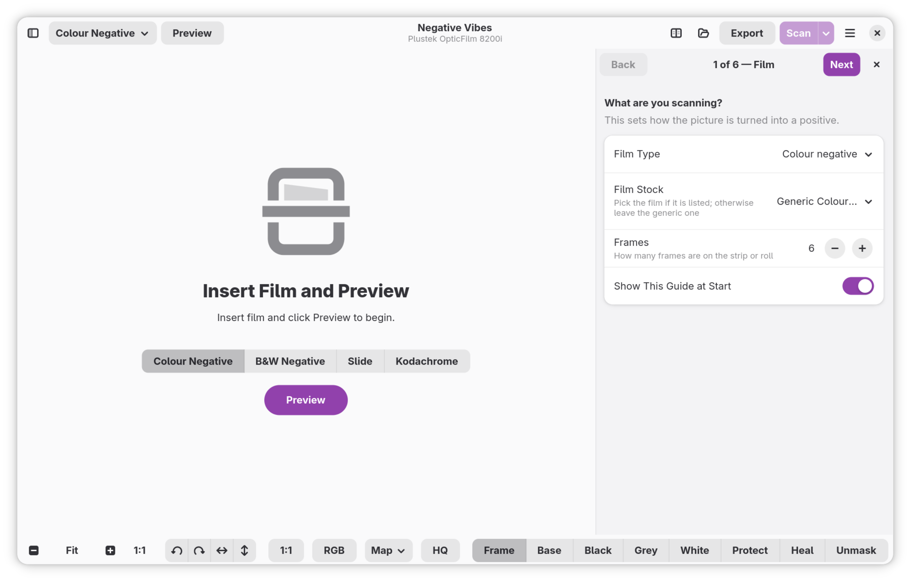
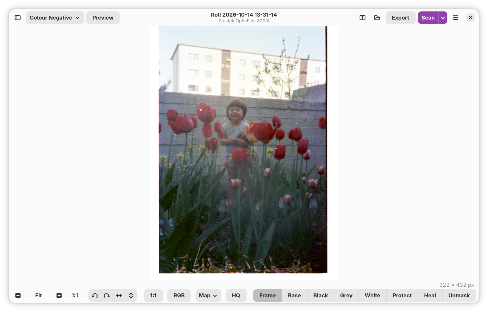
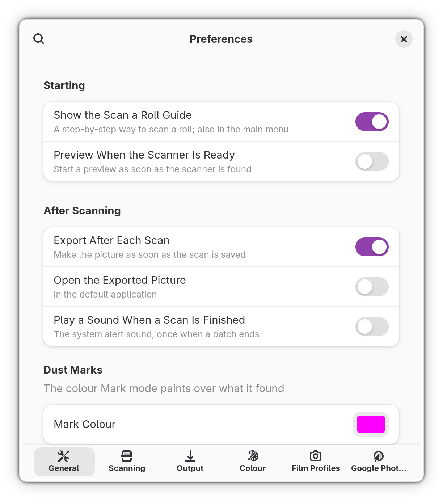
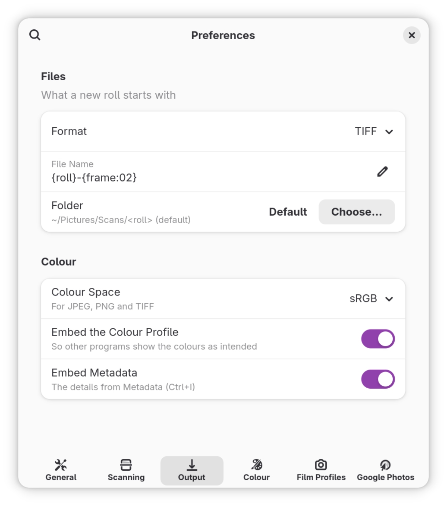
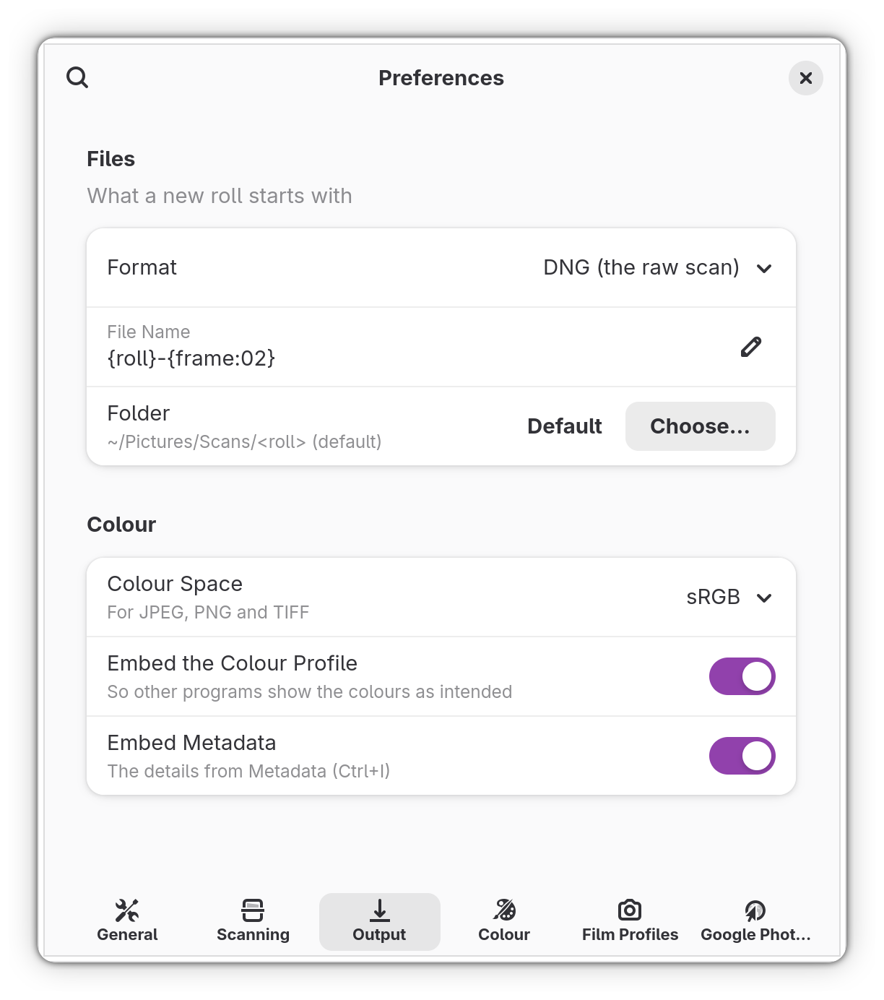

# Negative Vibes

A GNOME application for scanning colour and black-and-white negatives and slides on
any film-capable scanner that [SANE](http://www.sane-project.org/) supports.

The scan is kept exactly as the scanner delivered it (16-bit, linear, with the infrared
plane when the scanner has one). Everything else is a stack of settings applied on top, so
you can change your mind about the look at any time and export again.

## Scanner support

Negative Vibes was developed for use with the
[OpticFilm 8200i SANE backend](https://github.com/cschalle/OpticFilm8200i-sane) (the Plustek
OpticFilm 8200i, with its infrared channel), and that is the scanner it has been tested on. The
Flatpak build includes that backend.

Over time the aim is to support any major film scanner that SANE supports. For that to work well,
infrared (dust) capture needs to be standardised in SANE first: today each backend exposes its
infrared channel in its own way, so the app has to carry per-device knowledge (`data/devices.toml`).
A common convention in SANE would let new scanners work without it. Until then, other scanners
will scan, but infrared dust removal may be unavailable, and the software dust removal is the
fallback.

## Screenshots



*First start. Film type is one click away in the header bar (and as toggles on the empty
page), and the Scan a Roll guide sits beside the picture instead of in a window of its own.*



*A colour negative previewed and converted to a positive, with the tools for frame, film base,
black, grey and white points, dust protection and healing along the bottom.*

<p>
  
  
  
</p>

*Preferences: general behaviour, and output format (TIFF here, or DNG for the raw scan), file
naming, folder, colour space and embedded profile and metadata.*

## Features

- **Scanning:** preview, per-frame scan areas, Scan All with manual-advance prompts, Scan Raw
  Only, multi-sample and multi-exposure, infrared capture, cancel at any time. The app reads
  what the scanner can do instead of assuming a model (`data/devices.toml` adds what SANE
  cannot report).
- **Scanner buttons:** a scanner that reports its front-panel buttons to SANE can drive the
  app with them. On the OpticFilm 8200i, QuickScan scans and IntelliScan previews. The
  buttons are watched only while the window is active, so the scanner stays available to
  other programs the rest of the time.
- **Rolls and frames:** settings for the whole roll with per-frame overrides, frame detection,
  resizable crop rectangles, rotate/flip, fine straighten, keep/reject, per-frame undo.
- **Negative conversion:** density-space inversion with film base, dye crosstalk and colour
  cast correction, roll analysis, and a film profile library with a profile builder.
- **Tone and colour:** levels, curves, pipettes, colour wheel, selective colour, IT8
  calibration (through ArgyllCMS), colour-to-grey.
- **Cleaning and detail:** infrared dust removal, software dust removal, brush masks, unsharp
  mask, noise reduction, local contrast, a 1:1 loupe.
- **Output:** TIFF, JPEG, PNG, DNG, HDR RAW and HDRi RAW; ICC profiles; XMP/IPTC metadata and
  an EXIF capture date; naming templates; an export queue.
- **Google Photos:** optional upload of each exported picture, into an album per roll (see below).

Help pages are in `help/` (open them with F1 in the app, or `yelp help/C`).

## Installing

The easiest way is the Flatpak, built automatically from the latest code on `main`.

```sh
# Once: add Flathub, where the GNOME runtime comes from
flatpak remote-add --if-not-exists --user flathub https://dl.flathub.org/repo/flathub.flatpakrepo

# Download and install the latest build
curl -LO https://github.com/cschalle/negative-vibes/releases/download/latest/negative-vibes.flatpak
flatpak install --user negative-vibes.flatpak

flatpak run io.github.cschalle.NegativeVibes
```

To update, download the bundle again and run the same `flatpak install` command. The Flatpak
is rebuilt whenever the program changes (not for edits to the documentation or screenshots), and
each build is also published as an OCI image on
[GitHub Packages](https://github.com/cschalle/negative-vibes/pkgs/container/negative-vibes).
Builds from other branches and pull requests are available as workflow artifacts on the
[Actions](https://github.com/cschalle/negative-vibes/actions/workflows/flatpak.yml) page.

## Building

Requirements:

- Rust 1.88 or newer (the code uses edition 2024 and let chains), and Meson 1.4 or newer;
- GTK 4.14 and libadwaita 1.4 or newer, with their development files;
- the SANE development files (`sane-backends-devel` on Fedora, `libsane-dev` on Debian and
  Ubuntu), because the app links libsane;
- the gettext tools (Meson's translation support needs them).

Optional at run time: Yelp for the help (F1) and ArgyllCMS for IT8 calibration. There is no
Blueprint or lcms2 dependency, and no libclang: the libsane bindings are checked in.
`cargo test --workspace` needs only Rust, GTK, libadwaita and the SANE headers; Meson is for the
installed build.

```sh
meson setup _build
ninja -C _build
./run-devel.sh            # runs the development build from Cargo
cargo test --workspace    # headless tests for every crate
```

To build the Flatpak yourself:

```sh
flatpak-builder --user --install --force-clean build-flatpak build-aux/io.github.cschalle.NegativeVibes.json
```

`build-aux/` also has a development manifest (`*.Devel.json`); `build-aux/flathub/` has the one
for a Flathub release (see the notes there).

## Google Photos

Exports can be sent to Google Photos as they are written (Export dialog, or the *Google Photos*
preset; sign in under Preferences). The app asks only for the add-only scope
(`photoslibrary.appendonly`), keeps the refresh token in the system keyring, and puts each roll in
an album it creates itself.

Sign-in needs a Google OAuth client of type *Desktop app* with the Photos Library API enabled.
Build with `NV_GOOGLE_CLIENT_ID` and `NV_GOOGLE_CLIENT_SECRET` set to bake yours in, or leave them
out and each user enters their own under Preferences > Google Photos. A client used by people other
than the Google Cloud project's test users has to pass Google's app verification first.

## Command line

`nv-cli` shares the scanning and processing code with the app: `scan`, `probe`, `render`
and `calibrate`. Run `cargo run -p nv-cli -- --help`.

## Layout

| Path | What |
|---|---|
| `src/` | The GTK application |
| `crates/nv-sane`, `nv-device`, `nv-acquire` | SANE binding, capabilities, acquisition |
| `crates/nv-process`, `nv-film`, `nv-export` | Pipeline, film profiles, output |
| `crates/nv-store`, `nv-calibrate`, `nv-cli` | Roll storage, IT8 calibration, CLI |
| `DESIGN.md` | How the application works: architecture, scanner layer, pipeline, testing, status |
| `docs/` | The original design history; the scanner portal proposal and prototype |

## Contributing a film profile or a scanner

Scanner quirks go in `data/devices.toml` (the header describes each field). Film profiles are
single JSON files; build one with *Create Film Profile…* from a scan of unexposed film base
and a grey step wedge exposed on the same stock, and send the file.

## Licence

GPL-3.0-or-later.
