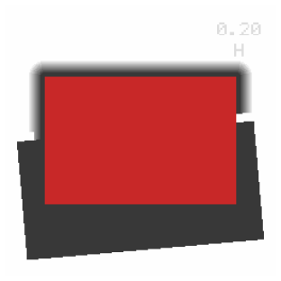
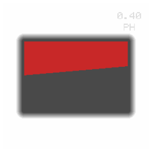

# Slanted-edge PSF target

A 3D-printable carrier, shaped like a 35 mm slide mount, that holds a
double-edge safety razor blade across the scan aperture at a slight angle.
Scanning it gives a knife edge from which the scanner's line spread function
and MTF can be measured.

## Why a carrier and not a printed edge

The thing being measured is a transition about 2 px wide at 3600 dpi — some
14 µm. For the target not to dominate the result, its edge has to be straight
to well under that at spatial periods shorter than roughly a millimetre.
Slower wander than that the edge tracker follows out; faster roughness it
cannot, and that roughness lands directly in the measurement.

| source of edge | roughness | at 3600 dpi |
|---|---|---|
| FDM print | ~100 µm | ~14 px |
| Resin print | 20–35 µm | 3–5 px |
| Double-edge razor blade | < 1 µm | < 0.15 px |

So nothing printed is used as an optical edge. The print supplies the
outline, the height and a repeatable angle; the blade supplies the edge.

A hand-cut piece of flat plastic was tried first and measured a 7.71 px rise
where the holder's own mask edge in the same scan measured 2.98 px. Edge
roughness and height error together, not the scanner.

## What to put in it

The pocket takes any opaque strip roughly 20–22 mm wide and 45 mm long. In
descending order of how good the edge is:

| strip | thickness | edge | notes |
|---|---|---|---|
| Double-edge razor blade | 0.10 mm | < 1 µm | 43 × 22 mm, flat, no spine. Best, and what the pocket is sized for. |
| Black developed film | 0.14 mm | ~10 µm | A fogged leader or trailer. Slit to camera tolerance. Cut to ~21 mm wide, keeping one factory edge. |
| Black silicone tape | ~0.5 mm | soft | Trim to ~21 mm. Slit but compliant, and the edge tends to be rounded rather than square. |

A double-edge blade's central slot sits 11 mm from the cutting edge, and
measurement only ever uses a window of about ±0.3 mm around the edge, so the
slot never enters it.

The strip is located by its **optical edge** butting against a fence, not by
its width against the back wall, so width within that range does not matter.
The fence exists only outside the aperture; across the open area the edge is
untouched.

Every scan also contains the holder's own mask edge, which measured 2.98 px
on this scanner. If the strip's edge comes back much softer than that, the
strip is the limit and not the scanner — so a bad strip diagnoses itself in
one scan.

## Second generation: a frame that the holder can hold

The six `psf-target-*` STLs above are the first design: a `base` mm plate
with the pocket ridges standing on it, so the part is `base + 1.0` mm
overall. Three of them were printed and scanned at 3600 dpi. Measured over
the field they share, 10-90% rise in tenths across the frame:

| base | left to right | best | mean |
|---|---|---|---|
| 0.7 | 7.34 6.75 6.21 5.87 5.58 5.00 4.65 4.32 3.98 3.78 | **3.78** | 5.43 |
| 1.0 | 7.22 6.90 6.64 6.57 6.53 6.40 6.15 6.02 5.91 5.83 | 5.83 | 6.48 |
| 1.3 | 6.43 6.50 6.53 6.60 6.87 7.13 7.50 7.57 7.72 8.05 | 6.43 | 7.08 |

Film's own in-focus edge on this scanner is 1.9-2.9 px, so none of them is
there yet, and two things come out of the table.

Blur falls as the blade goes down, and falls faster at 0.7 than at 1.0
(3.49 px/mm against 2.02): the focal plane is below 0.7 mm and the sweep has
to continue. But the plate cannot simply be made thinner, because at
`base 0.25` the whole part would be 1.25 mm, under the 1.3 mm a slide holder
will take.

And the gradient across the field is different for every part -- the 0.7
falls 3.56 px, the 1.0 falls 1.39, the 1.3 *rises* 1.62 -- on one holder,
one scanner, one pair of blades. Each part is sitting at its own tilt, which
is what a 1.7 to 2.3 mm part does in a slot that takes 1.3 to 3.2.

`make_framed_target.py` answers both. The part is a solid 2.6 mm block with
the pocket sunk into it as a trench, so the blade's height and the outline's
thickness stop being the same number. The trench is an island, not a
channel: a 43 mm blade in a 50.8 mm mount leaves at least 2.3 mm of
full-thickness frame all the way round. Above the blade's plane the aperture
opens outward at 45 degrees, so a 2.6 mm block is not also a 2.6 mm deep
light tunnel; a hole that widens upward is additive and needs no support.




*Left, the carrier: red is open, dark is the trench the blade lies in, the
grey halo is the flare, and the engraving is at the top right. Right, the
printed-edge variant, where the dark half is the occluder itself.*

```
python3 make_framed_target.py                      # 0.20 0.35 0.50 0.65
python3 make_framed_target.py --base 0.3 --only h  # one height, one axis
python3 make_framed_target.py --printed 0.4        # no blade at all
python3 check_framed_target.py part.stl plan.pnm   # read the STL back
```

Every part carries its own height engraved into the top face with the
orientation letter under it, because a 0.15 mm difference in a printed part
is not something anyone can judge by eye.

### What the framed carriers measured

Printed and scanned on 2026-11-01, the four `-h` heights at 3600 dpi, same
field and same metric as the table above:

| blade height | 0.20 | 0.35 | 0.70 | 1.00 | 1.30 |
|---|---|---|---|---|---|
| per-row median rise | **2.74 px** | 4.13 | 5.77 | 6.95 | 7.53 |
| best tenth | **2.57** | 3.75 | 4.25 | 6.36 | 7.06 |
| edge waviness | 10 µm | 12 | 21 | 11 | 8 |
| edge roughness | 0.69 µm | 0.79 | 0.43 | 0.83 | 0.97 |

0.20 mm is the focal plane, and the proof is inside that one scan rather
than across the series. In twentieths across the field the rise falls to
2.55 px at the fourteenth and climbs back to 2.76, monotonically either
side: the carrier's own slight tilt carries the blade through focus and out
again, so the plane is straddled rather than approached.

Fitting blur² = b₀² + k²(h − h_focus)² across all five heights does **not**
work — it returns a negative curvature and a focal plane at +2.28 mm — so no
focal-plane figure is quoted from the series. The within-scan minimum needs
no model.

The frame did its job too. These parts wander 8–12 µm along the edge where
the old 0.7 mm carrier wandered 21 µm, and nothing here shows the
part-to-part reversal of field gradient that the first generation did.

`psf-framed-v-base0.20`, scanned the same way, gives the sensor axis:
per-row median 3.344 px, best tenth 2.64, waviness 6 um, roughness 0.67 um.
Its field gradient runs the other way from the `-h` part's, 2.64 rising to
4.03, which is each part sitting at its own tilt rather than anything
optical -- on the sharpest fifth of each the two axes agree to 5% out to
30 cyc/mm.

The resulting line spread functions are `psf-feed-3600.csv` and
`psf-sensor-3600.csv`, and what they mean for the pipeline is in
`../../imagetech.md`.

### Without a blade

`--printed` makes a target with no pocket: the occluder is printed, lying on
the build plate, and its own outline is the optical edge. Whether that is
good enough is for the scan to say, not this file. The first targets' own
aperture walls measured a median 10-90% rise of 3.99 px with a p10-p90 of
3.74 to 16.62 px -- the typical row fine, the rough ones very rough -- but
that wall is 0.7 mm of stacked layers, while this is one or two layers laid
against the build plate, which is the flattest surface an FDM printer makes.

Two consequences follow from where it has to go. It cannot float over the
aperture, so it lies on the plate and its edge sits at 0 to `--printed` mm,
below every height the carriers reach -- useful, given where the table above
points. And it is a wall rather than a sheet, so each depth through its
thickness lays its own defocused edge in the same place and the measurement
broadens. That, not roughness, is what sets its floor, which is why
`--printed` defaults to 0.4 mm and 0.2 mm is worth printing too.

The scan says immediately which it is. A rough edge shows up as scatter in
the per-row rise and in the straightness residual; a thick one shows up as a
rise that is too long everywhere, evenly.


## Printing

```
python3 make_target.py --base 1.0                  # both orientations
python3 make_target.py --base 0.7 --tilt 7         # variants
python3 make_target.py --strip-width 25            # untrimmed 1" tape
```

Those six STLs have served their purpose: printing and scanning three of
them is what produced the table above. **Print the `psf-framed-*` and
`psf-printed-*` parts now**, starting with the four `psf-framed-h-*`
heights, which sweep 0.20 to 0.65 mm along the axis the measurements so far
have been on. The two `psf-printed-h-*` are the blade-free variants and cost
nothing extra to try. The `-v` parts repeat both on the sensor axis.

- **Black** PLA or PETG. Not translucent, not white.
- 0.2 mm layers, which is also what the aperture flare is stepped at.
- No supports. Every feature is additive from a flat bottom face, the flare
  included: it opens upward, so each layer rests on one that reaches
  further in.
- 4 perimeters, or 100% infill.
- Overall 50.8 × 50.8 × 2.6 mm, inside the 1.3–3.2 mm a slide mount may be,
  and with at least 2.3 mm of that thickness unbroken around the outline.

For a `psf-printed-*` part the first layer is the measurement, so give it
whatever the printer does best: a clean bed, no brim crossing the aperture,
and no elephant's-foot compensation set so high that it eats the edge. A
uniform bulge there only shifts the edge, which the fit absorbs; what cannot
be absorbed is roughness along it.

**Check the first layer height before printing `psf-printed-h-0.20`.** Many
slicers default to a thicker first layer than the rest, 0.3 mm being common,
and a 0.2 mm occluder is then below one layer and is dropped without a
warning. The part still prints, and it prints an empty window: the scan
comes back as clear as open air, with no step in it anywhere. Set the first
layer to 0.2 mm for that one, or print `psf-printed-h-0.40` instead, which
survives a 0.3 mm first layer.

## Use

1. Lay the strip in the pocket, edge toward the open half of the aperture,
   and push it against the fence. **Handle a blade by its back, not its
   edge.**
2. If it rattles, a scrap of tape across the back holds it. Keep tape out of
   the aperture.
3. Load into the slide holder and scan at 3600 dpi, no infrared:
   `nv-cli scan <device> --dpi 3600 -o target.pnm`
4. `*-v-*` has the edge near vertical and measures the **sensor axis**;
   `*-h-*` has it near horizontal and measures the **feed axis**.

A `psf-printed-*` part skips steps 1 and 2 — there is nothing to put in it.

The tilt matters and is not cosmetic. A rigid edge aligned with the pixel
grid gives every scan line the same sub-pixel phase, so there is nothing to
interleave and the measurement collapses. Film only gets away with it because
it bows. 5° is comfortable; 2–15° all work.

## Checking the output

```
python3 check_target.py psf-target-v-base1.stl 5 1.0 plan-v.png
```

Prints the bounding box and whether the part stays inside the slide outline,
and draws a plan view with the aperture in red and the blade's cutting edge
in orange. `plan-v.png` and `plan-h.png` are the two committed views.

For the second-generation parts:

```
python3 check_framed_target.py psf-framed-h-base0.20.stl plan.pnm
```

That one reads the STL back rather than re-running the generator's own
arithmetic, so it measures the solid that will actually print: bounding box,
the area at each height, how far material reaches into the aperture, and the
narrowest place where the outline is not at full thickness.
